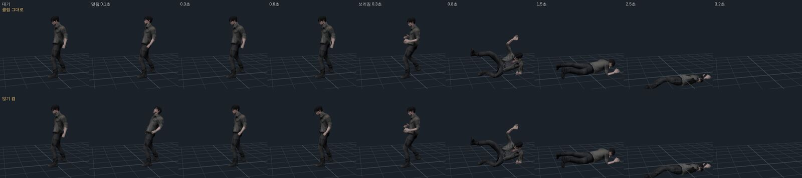
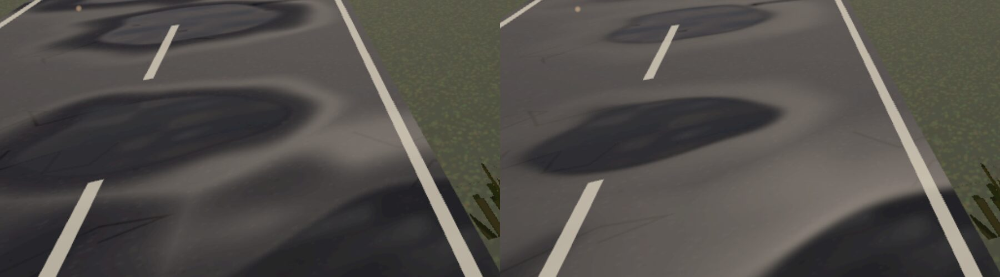
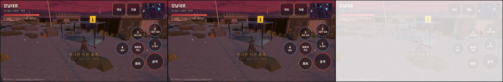

# 229 · 도시를 «스파이더맨2 처럼» — 웹·휴대폰에서 되는 것부터

디렉터: «맵을 스파이더맨2 정도로 구현할수 있을까?» → «6시까지 진행해».
그대로는 못 한다(PS5 · 큰 팀 · 실시간 레이트레이싱). 그 게임이 도시를 «꽉 차 보이게» 하는 요령 중 휴대폰 웹에서 되는 것부터 차례로 넣는다.

| 요령 | 상태 |
|---|---|
| 가짜 실내 창 (interior mapping) | **§1 — 넣음** |
| 물체 발밑 그늘 (차·소품) | §2 |
| 먼 건물 창 불빛 | §3 |
| 반사(큐브맵) · 교통 · 군중 · 원경 LOD | 다음 |

## 1. 가짜 실내 창 — `js/mmo/facade-shader.js`

강남대로 같은 OSM 필드의 건물 벽(3D 만, 2D 굽기는 그린 창 그대로)에:
- 벽마다 자기 세계 좌표로 창 칸(가로 1.8 m × 층 3.6 m, 1층은 가게 띠라 비움). ExtrudeGeometry 의 UV 는 비스듬한 벽에서 늘어나 안 썼다
- 창 안의 점마다 시선 반직선을 방 상자(뒷벽·옆벽·바닥·천장)와 만나게 해 맞은 면을 칠한다 — 방 모형 없음, 텍스처 더 안 읽음
- 방마다(칸 해시) 벽 색 셋 · 깊이 0.9~1.6 배 · 뒷벽 가구 · 블라인드 · 깨진 창 10 % · 켜진 방 3~11 %(밤일수록, 천장 등에서 둘레로 어두워짐)
- 벽마다 뚫린 창 / 띠창(커튼월 38 %) · 창틀 · 유리는 보는 각·칸 높이에 따라 지금 하늘빛을 비춤(프레넬)
- 멀면(`fwidth` 로 칸이 화소보다 작아지면) 벽과 유리를 창 몫만큼 섞은 평균색 — 모아레 방지
- 시간대: `FACADE_U.uLampK`(가로등 세기) · `uSkyRefl`(하늘 지평선색) 을 world3d 의 시간대가 넣는다. `?im=0` 으로 끔

지표·함정: 켜진 방 빛을 처음 0.9 + 1.6k 로 줬더니 밤에 하얀 판으로 타서(블룸) 방 모양이 안 보였다 → 0.45 + 0.55k.
`R()` (공용 난수) 로 벽 텍스처를 그렸으면 뒤의 건물 높이·차 자리가 2D 굽기와 달라졌다 → 따로 굴리는 난수.
시험 `tests/facade-shader.test.mjs`: 표준 재질 셰이더 다섯 자리(세계 좌표·칸·거칠기·금속·스스로 빛)에 다 들어가는지 — 끼울 자리 이름을 틀리게 하면 실패하는 것 확인.

## 2. 발밑 그늘 — `js/mmo/contact-shadow.js` (`?cs=0` 으로 끔)

장면 맨 위 물체 중 «바닥에 선(밑 0.35 m 안), 높이 0.25~4.5 m, 발 넓이 0.3~40 m²» — 차·버스·벤치·쓰레기통… 강남대로 295개. 자기 축(회전 포함)대로 둥근 사각 그늘 한 장, InstancedMesh 하나(그리기 1번).
빛나는 것(결정)·투명한 것·건물·바닥 판은 뺀다. 길(0.06)·횡단보도(0.075) 위 0.085 m.

함정: 첫 판(동그라미, 둘레 0.27 m)은 진한 가운데가 통째로 차 몸 밑에 숨어 보이는 건 옅은 꼬리뿐이었다 — 빨갛게 칠해 자리는 맞는 것을 먼저 확인하고(`window.__CSH` = 개수),
가운데를 발 넓이 62 % 로 넓히고 둘레 1.7 m 로 직선 감쇠 → 차 옆 바닥이 또렷이 어두워졌다.

## 3. 먼 건물 창 불빛

먼 도시(`env-lib.js` farCity)는 이미 창 불빛만 그린 발광 지도가 있다(문서 219) — 그대로.

## 4. 스카이라인 윤곽 — 처마·층 띠 · 셋백 · 항공 장애등

- 처마 띠(코니스, 벽에서 0.32 m)·1층 위 띠(0.22 m)·30 m 넘는 건물은 4 층마다 얇은 띠(건물마다 55 %) — `buildingDeco` 의 새 칸 `ledge` (난간과 같은 콘크리트). 3D 꾸밈을 쓰는 모든 빌더에 들어간다
- 셋백: OSM 필드의 45 m 넘는 탑 60 % 는 72 % 높이(층 단위)에서 윤곽을 78 % 로 줄인 윗몸 — 테라스 난간·처마가 그 높이에 생긴다. 막이·가게 띠는 땅 윤곽 그대로
- 항공 장애등: 50 m 넘는 탑 꼭대기 가장 먼 두 모서리에 붉은 등, 1.6 s 마다 0.55 s 켜짐(밤일수록 밝게). 재질 하나를 world3d 가 깜빡인다(`aviBlink`)
시험: `world3d-deco` — 처마·층 띠도 벽에서 0.6 m 안(일부러 0.9 m 로 내밀면 실패), 지붕을 안 꾸미는 건물엔 1층 위 띠만.

55 m 높이에서 본 강남: 셋백 탑이 보이고, 낮엔 안개(70~230 m, 존 분위기)에 먼 것이 묻힌다 — 스파이더맨처럼 멀리 트인 시야는 안개를 바꾸는 일이라 디렉터 판단.

## 5. 다른 도시로 — 여의도·판교·남태령… (env-lib `buildings`)

`interiorFacadeMats()` 를 facade-shader 로 옮겨 강남(env-osm)·다른 도시(env-lib) 가 같이 쓴다. `setInterior(q.get('im') !== '0')` 로 모든 빌더가 같이 켜고 끈다.
유리 커튼월 탑(45 m 넘는 `o.curtain` 건물 — 여의도)은 `interiorCurtainMat()`: CURTAIN 정의로 층마다 얇은 슬래브만 두고 전면 유리, 색유리(방이 덜 비침) · 하늘 반사 더 — 낮엔 청회색 유리판, 밤엔 사무실 불이 띄엄띄엄.
폐허 벽(무너진 저층)은 그대로(불 켜진 창이 있으면 안 된다).

## 6. 창 밑 실외기

45 m 아래 건물(옥상 꾸미는 건물) 벽마다 창 칸 9 개 중 하나꼴로 창 밑 실외기(0.82 × 0.55 × 0.32 m, 벽에서 0.19 m). `buildingDeco` 의 칸 `wallac`(옥상 실외기와 같은 재질).
자리는 가짜 실내 창과 **같은 격자** — 벽 따라 s = 위치·(nz, −nx) 의 1.8 m 칸 가운데, 층 3.6 m 의 창 아래(+0.33 m). 시험 `world3d-deco`: 모든 실외기가 칸 가운데(s/1.8 의 소수 0.5)·층 높이에 — 칸을 0.3 으로 밀면 실패.

## 7. 붉은 벽돌 빌라

서울 저층은 벽돌 빌라가 많다 — 18 m 아래 건물의 반(건물 id 해시)은 붉은·갈색 벽돌(0.24 × 0.075 m, 줄눈·벽돌마다 색 흔들림·빗물 그을음) + 같은 가짜 실내 창. `pickFacade()` 가 두 빌더(env-osm·env-lib)에서 고른다. 2D(벽돌 없음)는 예전 넷 중 하나.
시험 `facade-shader`: 저층 벽돌 비율 0.4~0.6 · 높은 건물은 벽돌 아님 · 같은 건물은 늘 같은 벽.

## 8. 낮 대비 손질

같은 자리(강남대로, 60 m 뒤) 전/후를 견주니 낮엔 그린 창(노란 켜진 창)보다 회색으로 납작했다 → 유리 알베도 0.22 → 0.15, 하늘 반사를 칸 위쪽일수록 세게(0.35 + 0.9 q.y²), 켜진 방 빛 0.45 + 0.55k → 0.8 + 0.37k(낮에도 켜진 방이 보이고, 밤은 그대로 ≈ 1.5).

## 9. 세로 네온 간판

서울 밤거리의 얼굴은 건물 모서리에 세로로 달린 네온(호프·노래방·PC방·치과·약국·모텔·당구장·학원). `buildingDeco` 의 칸 `vsign`:
9~40 m 건물의 60 %(id 해시)에 하나, **가장 가까운 길(40 m 안)을 보는 벽**의 한쪽 끝에서 벽과 직각으로 0.85 m 내밀어 1층 가게 띠 위(4.3 m)부터 최대 7.5 m.
- 처음엔 «가장 긴 벽» 에 달았더니 강남 22 개 중 길에서 보이는 게 거의 없었다 → env-osm 이 `nearestRoad` 의 가장 가까운 점을 `front` 로 넘기고, 바깥 법선이 그쪽을 가장 곧게(cos > 0.5) 보는 6 m 넘는 벽을 고른다. 다른 도시(env-lib)는 front 가 없어 가장 긴 벽.
- 한 장(512 × 256)에 8 칸, 칸마다 글자 세로. 넓은 두 면(길 따라 걷는 사람이 보는 면)만 글자, 좁은 앞면·위아래는 테두리 네온 색 한 줄 — 첫 판은 0.16 m 앞면에 글자가 찌그러져 찍혔다.
- 재질 하나(`VSIGN.mat`)의 세기를 world3d 시간대가 `0.3 + 0.9·lampK`(낮 0.3 · 밤 2.0)로.
- 강남 28 개(`__W3D.vsigns` 로 자리 확인). 셋백 테라스·땅 윤곽 가게 띠 호출은 `vsign: false`(겹치지 않게).

시험 `world3d-deco`: 건물 하나에 많아야 하나 · 벽에서 1 m 안 · 1층 띠 위 · front 를 아래/오른쪽에 두면 그 벽에만(front 를 무시하게 고치면 실패 확인) · `vsign:false` 면 없다.

## 10. 젖은 길 웅덩이

스파이더맨 밤거리는 길이 젖어 하늘·불빛을 비춘다. 반사 버퍼(SSR·평면 반사)는 휴대폰에 비싸서 길 재질(env-osm `roadMat` · env-lib `roadM`, 3D 만)에 셈만 더한다 — `js/mmo/puddle-shader.js`.
- 자리: 4.5 m 칸마다 60 % 에 비스듬한 타원 웅덩이 하나(긴 반지름 0.9~2.5 m, 이웃 9 칸 중 가장 가까운 것), 가장자리는 0.8 m 잡음으로 흔든다. 둘레 0.7 배까지 «젖은 띠».
  - 1·2판은 값 잡음 문턱이라 등고선이 구불구불한 물줄기(기름 줄)처럼 이어졌다 → 칸 타원으로. 위에서 빨강(웅덩이)·파랑(젖음)으로 칠해 분포를 확인했다(길 위 떨어진 덩어리).
- 웅덩이 안: 알베도 0.5 배 · 거칠기 0.05 · 금속 0 → 가로등·불꽃 결정 같은 점광원이 또렷이 맺힌다.
- 하늘 반사: 창과 같은 공용 `uSkyRefl` × (0.55 + 1.1 · 프레넬⁴). 1.6 배로 올렸더니 낮은 시선 낮에 눈·페인트처럼 하얬다 → 1.1. 여의도(넓은 길) 밤엔 자줏빛 하늘이 그대로 비쳐 페인트 얼룩 같았다 → 채도 40 % 빼고 밤엔 0.76 배(0.52 는 거의 안 보였다 · 밤 웅덩이의 밝은 것은 하늘이 아니라 불빛).
- **처음엔 아무것도 안 보였다**: world3d 의 «땅 결» 패치(문서 220)가 평평한 바닥 재질의 `onBeforeCompile` 을 통째로 덮어썼다. 이제 앞 패치를 이어 부르고(`prevBC`) 캐시 키도 `'ground-macro' + 앞 키`. 땅 결이 거칠기를 0.74 로 올리는 건(낮은 해에 젖은 길이 하얗게 번지던 것, 문서 217 §2) 그대로 — 웅덩이 칸에서만 0.05.
- 끄기: `?wet=0`.

시험 `puddle-shader`: 다섯 자리 주입 · 공용 유니폼 · `?wet=0` 이면 손 안 댐 · 3D 길에만 · 땅 결이 이어 부르는지(이어 부르기를 빼면 실패, 하늘 반사 자리를 깨면 실패 확인).

## 11. 가로등과 빛 기둥

스파이더맨 밤거리의 «공기 속 빛» — 가로등 밑으로 떨어지는 빛 원뿔. 부피광은 휴대폰에 비싸서 `js/mmo/light-cones.js`: 등마다 위가 뾰족한 원뿔 하나(InstancedMesh 한 번 그리기), 더하기 섞기 · 깊이 안 씀.
- 밝기 = 등 색 × lampK × 가장자리(시선과 비스듬한 면은 흐리게, cos³) × 높이(등 밑 진하고 땅에서 0) · 90~160 m 에서 거둠. 낮(lampK 0)엔 0.
- 대상: world3d 가 장면에서 떼어 낸 점광원(`pointData`) 중 높이 4 m 넘고 닿는 거리 12 m 넘는 것(벽 간판 7 m·결정 불빛 0.8 m 는 뺌). 실제로 비추는 건 가까운 4~8 개뿐이지만 원뿔은 모두에 있어 **먼 가로등도 켜져 보인다**.
- **강남엔 가로등이 하나도 없었다**(빛 기둥 0 · 여의도 14). `street()`(3D 만)에 큰길(primary·secondary·tertiary) 양쪽 34~40 m 마다 엇갈려 가로등: 길가 0.8 m · 8.5 m 기둥 · 차도 쪽 2.4 m 팔 · 셋 중 둘 켜짐(점광원 18 m). 머리 발광 `STREETLAMP.mat` 은 시간대가. 강남 켜진 등 45 · 여의도 85 · 대전 29(필드 가로등 포함).
- 세기 맞추기: 0.075·0.12 는 안 보였고(가까운 등), 10 배 디버그로 자리(등 밑~땅)를 확인 — 그 세기로는 딱딱한 고깔(천막)이라 가장자리 cos^1.6 → cos³ · 땅에서 0 으로 바꾸고, 가운데 밝기가 디버그의 절반쯤 되게 0.9·lampK.
- 끄기 `?lc=0`(빛 기둥만 — 가로등 기둥·점광원은 남는다).

시험: `light-cones`(높이·거리 거름 — 거리 조건을 빼면 실패 · 원뿔이 땅~등 밑 · 낮 0 · 점광원 떼어 낸 뒤 만든다) · `world3d-street` 가로등(큰길 양쪽에만 — 골목에도 세우게 하면 실패 · 기둥이 차도·건물 위 아님 · 켜진 비율). 소품 꼭짓점 비교 시험은 기하 없는 점광원을 거른다.

## 12. 유리에 비치는 도시 (큐브맵 반사)

스파이더맨의 유리 탑은 하늘과 이웃 탑을 비춘다. 지금까지 유리는 «지금 하늘빛 한 가지»(uSkyRefl)만 비췄다. `js/mmo/env-reflect.js`:
- 지역을 열 때·시간대 이름이 바뀔 때(새벽·낮·황혼·밤)만 스폰 위 22 m 에서 큐브맵을 굽는다(데스크톱 256 · 휴대폰 128, HalfFloat · 밉맵). 6 면 그리기라 휴대폰에선 그 한 번에 잠깐 끊길 수 있다(헤드리스는 GPU 를 못 잰다).
- 굽는 동안은 유리 반사를 끈다(`uEnvK` 0) — 큐브 안 유리가 지난 큐브를 비추는 되먹임. 시험이 이걸 본다(끄는 줄을 빼면 실패).
- 가짜 실내 창 셰이더(`FACADE_U.uEnvCube/uEnvK`): 시선을 벽에 꺾은 방향으로 읽는다. 일반 창은 하늘빛 자리만 큐브로 바꾸고(약하게), **커튼월 유리는 거울**: 프레넬에 따라 50~90 % 를 큐브 색으로(켜진 방·깨진 창은 덜).
- 한 점에서 찍었으니 시차는 틀리다(먼 탑은 엉뚱한 쪽을 비춘다) — 그래도 하늘 한 가지 색보다 «도시가 비친다». 유리만 큐브로 칠해 보는 디버그로 하늘·먼 스카이라인 실루엣이 담긴 걸 확인했다.
- 끄기 `?refl=0` (`?im=0` 이면 같이 꺼짐).

여의도 같은 카메라: 낮엔 푸른 하늘과 먼 스카이라인, 황혼엔 붉은 노을과 이웃 탑 실루엣이 유리에 비친다.

## 13. 디렉터 결정 — «멈춘 도시» · 지역마다 다른 간판

**디렉터 2026-10-10: 「멈춘 도시 맞아」.** 원작 «서울은 무너진 게 아니라 멈춰 있었다» 대로 거리의 사람·차는 움직이지 않는다 — 스파이더맨의 차량 흐름·군중은 들이지 않는다(후보에서 뺌).
도시의 «살아 있음» 은 빛(창·간판·가로등·반사)과 날씨·까마귀·연기(문서 219)로만.

그래서 간판이 지역을 말하게 했다 — 세로 네온(§9)의 8 칸을 지역 묶음으로 (`setVsignTheme(ZONE)`, 묶음마다 재질 하나):
| 묶음 | 지역 | 글자 |
|---|---|---|
| 서울 번화가(기본) | 강남·남태령·대전 … | 호프 노래방 PC방 치과 약국 모텔 당구장 학원 |
| 바닷가 | 부산·해운대·여수·목포·속초·경포·제주·서귀포·고흥 | 횟집 모텔 민박 조개구이 노래방 약국 횟센터 호프 |
| 업무지구 | 여의도·판교 | 약국 치과 커피 은행 안과 편의점 호프 PC방 |
| 옛 도심 | 전주·경주·수원·춘천 | 한식 여관 다방 약국 막걸리 서점 노래방 국밥 |
네 글자(조개구이)는 40 px 로 조금 작게. 시험 `world3d-deco`: 지역 → 묶음(전주를 빼면 실패) · 묶음마다 8 칸 · 2~4 글자.

## 14. 안개 너머는 안 그린다 (먼 것 덜어내기)

먼저 쟀다(장면 메시를 종류·카메라 거리별로, 같은 시점 렌더 한 번):
- 필드 안개는 70~230 m — 230 m 너머는 안개 색에 완전히 묻힌다. 그런데 강남은 77만 삼각형 중 약 13만을 200 m 너머에서 그렸다.
- 지역 전체를 한 메시로 덮는 인스턴스(차·바퀴·나무·바위)는 거리와 상관없이 다 그렸다 — 여의도 40만.

`js/mmo/fog-cull.js` — 지역을 지은 직후(플레이어·몹·까마귀가 들어오기 전) 장면 바로 밑 정적 메시·인스턴스를 모아, 10 프레임마다:
- 정적 메시: 월드 경계 구가 (안개 끝 + 25 m) 밖이면 숨김. **자기가 숨긴 것만 되살린다**(다른 기능이 일부러 숨긴 건 그대로).
- 정적 인스턴스: 원래 행렬을 들고 있다가 가까운 것만 앞으로 모아 count 를 줄인다(색도). 고른 것이 같으면 다시 올리지 않는다.
- 안개를 안 받는 것(먼 도시 실루엣 `fog:false`, 하늘, 빛 기둥 같은 ShaderMaterial)은 손대지 않는다. 남이 인스턴스 행렬을 고치면(움직이는 무리) 손 떼고 count 를 돌려 둔다.

| 지역 (같은 시점) | 끔 → 켬 | |
|---|---|---|
| 여의도 | 124만 → 77만 | −38 % |
| 강남 | 77만 → 73만 (호출 712 → 611) | −6 % |
| 전주 | 101만 → 96만 (호출 654 → 585) | −6 % |
| 여의도 55 m 높이 | 128만 → 94만 | |

화면은 그대로여야 한다 — 켬/끔 같은 카메라 픽셀 차이 평균 0.07/255(여의도 55 m)·0.15/255(강남 낮은 시선), 같은 설정을 두 번 찍은 차이(0.25)보다 작다.
끄기 `?fc=0`. 시험 `fog-cull`: 숨김·되살림·여유 · 실루엣/셰이더 제외(빼면 실패) · 인스턴스 모으기·안 올리기 · 움직이는 무리 손 떼기(빼면 실패) · 남이 숨긴 건 그대로 · world3d 가 움직이는 것보다 먼저 모은다.

시야를 더 트는 것(안개를 뒤로)은 존 분위기를 바꾸는 일이라 디렉터 결정 — 이걸로 덜어 낸 몫이 그 여유다.

## 15. 장소마다 안개 (디렉터 «안개는 장소에 따라»)

지금까지 모든 필드가 70~230 m 한 값. `js/mmo/zone-fog.js` 표로 장소마다:
| 성격 | 지역 | 안개 (m) |
|---|---|---|
| 도심 협곡(기본) — 빌딩이 막는다 | 강남·대전·수원·판교·남태령 … | 70~230 그대로 |
| 강변 | 여의도 | 100~340 |
| 산 위 | 남산 | 120~400 |
| 바다 | 해운대·경포·제주·서귀포 110~380 · 속초·여수 100~360 · 목포 100~340 · 부산 90~320 · 고흥 120~400 | |
| 낮은 옛 도시 | 경주 90~300 · 전주 80~260 | |
| 짙은 곳 | 춘천(호반 물안개) 45~170 · 계룡(산 밑) 45~165 | |
- 안개 덜어내기(§14)와 휴대폰 카메라 끝(안개 끝 + 10)이 이 끝을 따라간다. 지역 밖 300 m 의 먼 도시(`farCity`)는 실제 건물이라 끝을 밀면 그대로 보인다.
- 그리는 양(같은 시점·낮): 여의도 96만 → 109만(+13 %) · 해운대 88만 → 95만(+9 %) · 춘천 88만 → 76만(−14 %). 끝은 420 m 넘지 않게(시험).
- 견주기 `?fogf=230&fogn=70`(끝·가까이 덮어쓰기).
시험 `zone-fog`: 도심 그대로 · 트인 곳 ≥ 300 · 짙은 곳 < 200(춘천을 230 으로 돌리면 실패) · 표의 지역 이름이 실제 지역 · world3d 가 표를 쓴다.

## 16. 하얀 얼음판 웅덩이 고치기

디렉터가 본 것: 해운대·여의도 낮, 길 웅덩이가 하얀 얼음판처럼 보였다.
- 처음엔 옛 물 판(문서 220 §8, `street()` 의 물 재질)으로 짚었다 — 셰이더 웅덩이(§10)가 켜진 뒤로 같은 길에 웅덩이가 **두 겹**이었으니 옛 판은 이제 만들지 않는다(`?wet=0` 이면 예전대로 판이 돌아온다). **그런데 판을 없애도 하얀 판은 그대로였다** — 진짜 원인은 §10 셰이더 웅덩이가 낮 하늘색(밝은 회분홍) 한 가지를 모양대로 더한 것.
- 실제 길 웅덩이는 대부분 둘레 건물(어두움)을 비추고 트인 쪽만 하늘이 밝다 → 웅덩이도 §12 의 구운 주변 큐브맵을 위로 꺾은 시선으로 읽는다(채도 30 % 빼기 · 0.12 + 0.75·프레넬 · 물 알베도 0.6 배 더). 큐브가 없으면(`?refl=0`) 예전 하늘빛 식.
- 결과(같은 카메라): 해운대 웅덩이가 어두운 물 + 하늘 그라데이션 + 비친 건물. 밤엔 어둡고 불빛 반짝임만.
시험: `world3d-street` 셰이더 웅덩이가 켜지면 옛 판 0 · `puddle-shader` 큐브 유니폼·읽기.

## 17. 아파트 동 번호

한국 도시의 얼굴 — 판상형 아파트 벽 끝 위쪽의 큰 «101». OSM 건물 `kind: apartments`(여의도 81 · 해운대 39 · 강남 29 …).
- 번호: 이름에 번호가 있으면 그 번호(여의도 «11동»·«101동»·«E동», 해운대 «101»·«A»), 없으면 101~115 를 id 해시로. **단지 이름(상표)은 쓰지 않는다.**
- 자리: 15 m 넘는 아파트의 6 m 넘는 벽 중 가장 짧은 둘(벽 끝), 위에서 1.2 m 아래, 글자 높이 = 벽 길이 × 0.32(3.2~6 m), 벽에서 8 cm 밖(바깥 판정 — 반대로 감긴 윤곽도).
- 글자판 한 장(0~9 A~F, 1024 × 128) · 글자마다 사각형 · 꾸밈 메시에 합침(`aptGlyphs`). 걷는 구역 밖 먼 도시(`farCity`)의 아파트에도 — 여의도 아파트는 다 거기라 처음엔 0 동이었다. 강남 24 · 여의도 20 · 해운대 6.
- 고친 것 셋: ① `alphaTest 0.45` 는 멀리서 작은 밉맵으로 내려가면 획이 배경과 평균돼 통째로 버려졌다 — 빨강으로 칠해도 안 보였고, 메시는 화면 가운데에 투영되는데 그려지지 않는 걸 재서 찾았다 → 알파 섞기. ② 짙은 남색 글자는 어두운 벽에 묻혔다 → 밝은 글자 + 짙은 테두리. ③ 2.4~4.2 m 는 멀리서 점 → 3.2~6 m.
시험 `world3d-deco`: 이름 → 번호(상표는 안 씀·아파트만) · 벽 끝 바깥 0.1 m 안(바깥 판정을 빼면 반대 감김에서 실패 · 긴 벽을 고르면 실패) · 위쪽 · 15 m 아래 없음.

## 18. 폐허 도시의 불빛 줄이기 (디렉터 «폐허가 된 도시인데 불이 너무 많이 켜져 있는거 같어»)

먼저 쟀다 — 밤 넓은 시점(55 m)·같은 카메라, UI 를 뺀 화면에서 밝은 픽셀(휘도 > 0.5)·따뜻한 불빛 비율:
| | 전 | 후 |
|---|---|---|
| 여의도 밝은 / 따뜻한 | 0.69 % / 1.55 % | 0.45 % / 0.39 % (−75 %) |
| 강남 밝은 / 따뜻한 | 1.19 % / 0.87 % | 1.06 % / 0.64 % |
강남 거리 시점은 그대로(1.15 % / 1.55 %) — 거기 밝은 건 결정·불꽃(게임 요소)이지 전기 불빛이 아니다.

바꾼 것 — «생존자가 숨어 사는 몇 블록에만 불이 모이고 나머지는 거의 꺼진» 도시:
- 가짜 실내 창: 고르게 낮 7 % · 밤 15 % → 36 m 블록 18 % 만 «사람이 산다»(그 안 낮 8 % · 밤 14 %) · 나머지 0.6 %. 전체 밤 약 3 %. 멀리 평균색도 블록을 따른다.
- 먼 도시 창: 20 % → 5 %.
- 세로 네온: 켜진 것 30 %, 나머지는 꺼진 관(발광 없음·바랜 색 — 재질 `VSIGN.off`).
- 큰길 가로등: 셋 중 둘 → 30 %(빛 기둥도 따라 준다). 필드 가로등(3D)도 셋 중 하나 — 2D 굽기 값은 그대로.
- 항공 장애등: 반만(배터리).
- 그대로: 상가 간판 불빛(35 %·최대 40 — 2D 와 같은 장면 난수라 건드리면 2D 배치가 밀린다), 결정·불꽃.
시험: `world3d-deco` 켜진 네온 15~45 %(모두 켜게 하면 실패) · `world3d-street` 켜진 가로등 12~50 %(셋 중 둘로 돌리면 실패).

## 19. 옥상 다양화 · 3D 만 (디렉터 «2d는 신경쓰지마 3d만 할거야»)

CLAUDE.md §1.5 를 고쳤다 — 2D 굽기 결과가 달라져도 된다(장면 난수 소비를 아낄 필요 없음). 그래서 §18 에서 남겼던 상가 간판 불빛도 3D 는 35 → 15 %.

옥상(`buildingDeco` 의 roof):
- **옥탑방**(한국 옥상): 9~30 m · 넓이 80 m² 넘는 건물 35 % — 3.2~4.6 × 2.6~3.6 × 2.4 m 상자(바랜 베이지 벽 `shed` — 옥상 콘크리트와 같으면 묻혔다) + 파란 지붕 판 + 짙은 문.
- **격자 안테나**: 40 m 넘는 탑 40 % — 6~11 m 기둥 + 가로대 셋.
- **위성 접시**: 10~45 m 25 %.
- **이끼·풀 덤불**: 넓이 50 m² 넘는 옥상 40 % 에 2~5 덩이(납작한 다면체, 이끼색) — 자연이 옥상을 되찾는다.
강남: 옥탑방 11 · 안테나 19 (`__W3D.roofs` 로 자리 확인).
시험 `world3d-deco`: 옥탑방·이끼가 옥상 윤곽 안·옥상 위 · 높은 탑엔 옥탑방 없음(30 m 상한을 빼면 실패) · 옥상 안 꾸미는 건물엔 없음.

## 20. 옥상의 생존자 흔적

§18 의 «사람 사는 블록»(켜진 창이 모이는 36 m 칸 18 %)에 맞춰 그 블록 건물 옥상에 생존자가 산 흔적:
기울인 방수포 천막(파랑·주황) + 기둥 넷 · 빨래줄 + 빨래 3~5 장 · 텃밭 상자 + 푸성귀 · 빗물 받는 드럼통. 강남 19 곳.
- **해시를 바꿨다**: 블록 판정이 셰이더의 `sin` 해시라 GPU(32 비트)와 JS(64 비트)가 다른 값을 낸다 → 옥상 흔적과 불 켜진 창이 엇갈린다. 셰이더 `inhab()` · JS `inhabited()` 를 비트까지 같은 정수 해시(uint 곱·xor·shift, WebGL2)로. 사람 사는 블록을 빨강으로 칠한 디버그로 생존자 옥상이 그 안에 있는 걸 확인했다. 한 건물이 칸 경계에 걸치면 벽 일부만 «산다» — 구역 단위라 그대로.
- 블록이 바뀌어 같은 시점(강남 55 m)은 켜진 창이 거의 없는 쪽이 됐다 — 분포(JS 로 21 %)는 그대로.
시험 `world3d-deco`: 셰이더·JS 해시 상수 일치(셰이더 문턱을 0.25 로 바꾸면 실패) · 블록 비율 13~23 % · 사람 없는 블록엔 흔적 0.

## 21. 멈춘 순간 — 버리고 간 짐

«서울은 무너진 게 아니라 멈춰 있었다» — 사람들이 차를 버리고 떠난 자리(`frozenMoment`): 차 30 % 의 한쪽(문 쪽)에 1~3 개 —
캐리어(서거나 쓰러짐) · 쇼핑백 둘 · 넘어진 자전거 · 펼친 채 떨어진 우산 · 흩어진 종이. 자리·종류는 차 자리 해시, 막이 없음(밟고 지나간다), 종류별로 합친 메시 하나씩.
- 다른 도시 차(`cars()`)에도 강남처럼 문 열린 차 14 % · 트렁크 열린 차 4 %.
- 고친 것 둘: ① 강남 차 반복문 안의 `L` 이 도로 길이(숫자)로 가려져 `L.isView3d is not a function` — 지역이 안 열렸다(촬영이 10 분 멈춤 → 페이지 오류를 잡아 찾았다). ② 꾸밈 합치기에 색인 있는 기하(텃밭 상자)와 없는 기하(이끼 다면체)가 섞이면 통째로 실패 — 배포된 §20 빌드에서 이끼·푸성귀 묶음이 빠져 있었다 → 섞이면 모두 색인 없이.
시험 `world3d-street`: 같은 차는 늘 같은 짐 · 차에서 5 m 안 · 0.8 m 아래 · 짐 있는 차 60 % 미만(30 % 문턱을 없애면 실패).

## 22. 다리 난간

OSM 다리(`bridge` · `layer > 0`)는 판교 46 · 부산 39 · 남산 29 · 대전·여의도·수원 20 … — 지금까지 땅에 납작한 띠였다.
세계가 평평해(바닥 높이 없음) 다리 판을 띄우면 걷는 사람이 경사를 뚫는다 → 띄우지 않고 «다리로 읽히게»(`bridgeRails`):
다리 구간 양옆 길가 바깥 0.15 m 에 콘크리트 난간벽(차도 0.8 m · 보도 0.5 m) + 쇠 난간(1.05 m) + 기둥(2.4 m 마다) + 바닥 아래로 처진 거더 띠(물 위에서 판 두께). 계단은 뺀다. 막이 없음.
왕복 도로가 OSM 에서 두 줄이라 가운데 분리대에도 난간이 선다(실제 다리처럼).
시험 `world3d-street`: 난간이 차도 밖(폴리라인까지 최소 거리 — 난간을 차도 안으로 옮기면 실패) · 1.1 m 아래 · 막이 없음 · 다리만.
남은 것: 진짜 고가도로(띄운 판 + 교각)는 바닥 높이가 생기면 — 지금은 걷는 띠 밖 먼 경치로만 가능.

## 23. 전 지역 점검 · 먼 웅덩이 · 켠 기능 표시

**점검**: 3D 필드 21곳을 휴대폰(Pixel 7 가로) 크기로 하나씩 열어 페이지 오류·콘솔 오류를 모으고 황혼 화면을 찍었다 — 21곳 다 열림, 오류 0.
지역마다 콜 175(계룡)~920(제주) · 삼각형 59만(춘천)~139만(고흥) · 안개 끝 165~400 m.
- **먼 웅덩이가 분홍 페인트**(서귀포·경주): 시선이 눕는 먼 웅덩이가 노을 지평선을 거의 그대로 비춰 테두리 진 납작한 분홍 원판이었다.
  반사 세기를 물의 반사율(슐릭: F0 0.02 + (1−cos)^5, 상한 0.4)로 — 이전 `0.12 + 0.75·(1−cos)^4` 는 중간 각도에서 두 배였다. 채도도 70 → 50 %.
  그래도 한 색 원판이라 잔물결 법선(값 잡음 기울기 ×0.3)으로 비침을 흩었다 — ×1 은 구운 주변의 건물 그림자가 얼룩무늬로 박혔다. 젖은 테두리는 덜 어둡게(0.7 → 0.8).
**켠 기능 한 줄**: `?debug=1` 무게 표시와 `?bench=1` 결과 카드에 `창○ 그늘○ 물○ 빛○ 반사○ 컬○ · 안개 230 (숨김 n·m)` — 폰에서 `?im=0` … 을 바꿔 가며 잰 카드를 견줄 때 무엇이 켜져 있었는지 같이 남는다.
시험: `puddle-shader`(슐릭·잔물결 세기 — 옛 식으로 되돌리면 실패) · `world3d-bench`(여섯 기능·안개 끝이 두 곳에 — 하나 빼면 실패).

## 24. 밤 점검 · 밤 영웅 달빛 윤곽

**밤 점검**: 21곳을 밤(`?tod=night`)으로 다시 열었다 — 다 열림, 오류 0. 거리·빛 기둥·웅덩이는 읽힌다(여의도 코앞 웅덩이의 파란 초승달은 달빛 반짝임 — 그대로).
**영웅이 검은 그림자였다**: 밤 노출 1.75 에도 영웅 몸·갑옷이 거의 검었다(달빛 세기 0.22 · 금속 지도에 비출 환경 없음) — 3인칭 게임에서 내 캐릭터가 안 보이는 건 치명적.
빛을 하나 더 두면 장면 전체 셰이더가 무거워지니, 보스 윤곽광처럼 **영웅 재질에만** «가장자리 달빛(#9fb4ff) + 앞면 살짝 밝힘»(`js/mmo/hero-rim.js`).
- 세기 = 시간대 lampK: 낮·새벽 0 · 황혼 0.07 · 밤 0.32. 장비는 늦게 붙으니 `watchLooks` 가 새 메시마다(예열 컴파일 전) · 다른 사람 아바타도.
- 고른 값: 처음(윤곽 0.9 · 세기 0.5 · 법선 지도 법선)은 몸 전체가 반짝이 가루 얼룩의 은빛 조각상 → 기하 법선 · 세기 0.32 →
  A(윤곽 0.9 · 앞면 0.18)는 넝마 코트 끝이 자글자글 → **B(윤곽 0.6 · 앞면 0.35)** — 팔·코트의 제 색이 보인다.
- 앞서 붙은 패치(wind.js 천)는 이어 부르고 캐시 키에 앞 키를 붙인다. `?hr=0` 으로 끔.
시험 `hero-rim`: 끼워 넣기·앞 패치 잇기·한 번만 · 세기 곡선(밤 0.5 로 되돌리면 실패) · world3d 연결(앞 패치 잇기를 빼면 실패).

## 25. 온라인 3D 가 로딩 중 끊기던 것 — 다시 들어가기

밤 윤곽을 다른 사람 아바타에도 붙이고 2인 시나리오(`tools/field-mob-scenario.mjs`, 2D 한 명 + 3D 한 명)를 돌리니 **3D 쪽이 끝내 «연결 끊김 — 혼자 연습»** — 이번 변경 전 코드(HEAD)에서도 똑같이 실패했다.
- 재 보니: 3D 는 로딩 도중(필드 방 입장 → 그 뒤 보스 몸·예열 컴파일)에 들어가고, 헤드리스에선 그 뒤로 67 초 동안 메인 스레드가 바빴다.
  서버(`server/index.cjs` heartbeat)는 5 초마다 핑을 보내 다음 핑까지 답이 없으면 `terminate()` — 브라우저는 메인 스레드가 소켓을 안 읽으면 핑에 답을 못 한다 → 닫힘 코드 **1006**.
  휴대폰도 예열 컴파일이 수 초 걸리니 같은 일이 날 수 있다(디렉터는 안드로이드로 논다).
- 고침(클라이언트만 — 서버 무변경): `field-net` 이 닫힌 까닭(code)을 `closed` 에 싣고, world3d 는 **다른 접속(4001)·제한(4003)·정상 종료(1000)가 아니면 1.5 초 뒤 다시 들어간다**(실패하면 3 → 6 → 12 … 30 초, 여섯 번까지). 들어온 문(gate)으로 다시.
- 다시 돌린 2인 시나리오: 3D 준비됨 · 두 화면이 서버와 같은 몬스터 4마리(세대까지) · 2D 가 쓰러뜨린 몬스터가 3D 에서도 사라짐.
  «몬스터가 와서 때림(hurtBy)» 은 시나리오가 못 잡았다 — 3D 화면엔 맞은 숫자가 떠 있어 판정 기록 쪽 문제로 보인다(남은 일).
시험 `field-reconnect`: 가짜 소켓으로 code 전달(빼면 실패) · 다시 들어가기 조건(지우면 실패).

## 26. 5급 몸 6종을 실제 게임에 (디렉터 승인)

«5급 몬스터는 지금 구축해놓은게 있을건데?» — 있었다. GPT 가 만든 N01 5급 6종 몸(보행자·질주자·파쇄자·추적자·철갑병·공진자, `art/3d/monsters/n01-candidates/`, 휴대폰판 ≤2만 삼각형)이
**검수 후보**(`approved:false`)로 잠겨 `?n01Candidates=1` 에서만 보였고, 실제 게임은 임시 몸이었다. 디렉터 «6종 다 켜기»(2026-10-11) → `js/mmo/n01-body-catalog.js` `approved:true`.
- 휴대폰은 기본 경량본(`_mobile.glb`), `?n01Detail=high` 로 원본. 종별 몸은 그 종이 처음 보일 때 받는다(대전은 추적자 하나만 받는다).
- 몸이 없는 5급(갈고리손·포획자·등반자·밀치는 자·베는 자·부르는 자 … 지역 표 기준 15종쯤)은 계속 임시 몸. 4급 이상도 임시 몸.
- 대전 사냥터에서 승인 후 추적자가 진짜 몸으로(이름표 «검수 후보» 사라짐), 같은 무리의 잔향자·등반자는 임시 몸 그대로 — 재서 확인.
시험 `n01-tier5-visual-contract`: 6종이 실제 게임에 · 몸 없는 종은 임시 몸 · 승인 몸은 «임시 몸/검수 후보» 표시 없음(승인을 되돌리면 실패).

## 27. 몸 없는 5급은 비슷한 몸을 빌린다

디렉터 «몸 없는 5급도 비슷한 몸 빌려 써» — 카탈로그 5급 20종 중 제 몸이 없는 14종에 역할이 가까운 몸을 빌린다(`BORROW`, `js/mmo/n01-body-catalog.js`). 이름·능력·판정은 제 것 그대로, 몸만.
| 빌려 주는 몸 | 빌리는 종 |
|---|---|
| 질주자 | 등반자(벽 타는 기동) · 절단자(긁어 찢는 연속타) |
| 추적자 | 잠복자 · 감시자 |
| 파쇄자 | 갈고리손 · 밀침꾼(무거운 팔·어깨) |
| 철갑병 | 방패수 |
| 공진자 | 호각자 · 교란자 · 잔향자(신호·노이즈·잔향) |
| 보행자 | 포획자 · 운반자 · 투척자 · 기생자 |
- 빌린 종의 고유 기술 클립은 몸에 없다 → `motionFor` 가 공통 attack1/death 로 내린다(6종 몸 모두 attack1·death 가 있는 걸 GLB 에서 셌다). 공진자 오라 고리는 본인만.
- 여러 종이 한 파일을 빌리니 몸 받기 캐시를 종이 아니라 주소로 — 대전은 추적자·공진자·질주자 셋만 받는다.
- 4급 이상은 임시 몸(이제 만든다 — 디렉터).
시험 `n01-tier5-visual-contract`: 5급 전부 몸 있음 · 빌린 몸은 진짜 몸 주소 · 4급 이상 임시 · 주소 캐시(짝 하나를 빼거나 캐시를 종 열쇠로 되돌리면 실패).

## 28. «좀비처럼 서 있다» — 몬스터 몸짓 얹기

디렉터 «너무 좀비처럼 서 있는데? 이게 전투 상황이 아닌거지?» → 재 보니 **전투 중이 맞다**: 대전 사냥터에서 영웅 곁을 0.7 초마다 40 번 재니 가까운 표본 120 중 97 이 «공격» 상태.
서 있는 것처럼 보인 까닭(클립 시트로 셈): 대기 4 초가 거의 정지 · 공격 클립 셋(attack · attack1 · tracking_strike)이 1.3 초 제자리 팔 휘두르기로 같음 ·
공격 상태(예고 600 ms + 타격 + 회복)가 클립보다 길어 `LoopOnce`+`clamp` 로 끝 프레임 — **팔 벌리고 꼿꼿이 선 자세** — 에 멈춤.
디렉터 «그건 직접하자. 지피티 시키지 말고» → 클립은 그대로 두고 그 위에 뼈 몇 개만 더 돌린다(`js/mmo/mob-motion.js`, field-mobs 믹서 앞에서 걷고 뒤에서 얹음):
- 숨(늘) · 전투 대기(공격·맞음 뒤 4 초 동안 교전 무게 e): 숙임 · 무게 옮김 · 몸통 비틀기 · 고개가 표적으로 · 늘어진 팔을 앞으로 들어 할퀼 채비
- 공격: 클립 앞 15~65 % 에 0.6 m 디딤 + 숙임 + 좌우 번갈아 비틀기 + 팔 휘두름
- 축은 몸 공간(옆·위·앞)을 뼈 부모 공간으로 바꿔 돌린다 — 리그마다 뼈 축이 달라도 같은 쪽으로 굽는다.
- 고친 것 셋(시트로 봄): 몸째 내리면 발이 5~11 cm 파묻힘 → 내리지 않음 · 철갑병은 팔을 돌리면 방패가 머리 위로 납작 → 방패 든 몸(shield_bash 클립)은 팔 안 돌림 · 보행자 잽처럼 이미 앞으로 뻗은 팔을 더 돌리면 손이 하늘 → «늘어진 정도»(위팔→아래팔 아래 성분)만큼만.
- 검수 도구 `tools/3d/mob-motion-sheet.html?id=G5_STALKER` — 실제 createMobView 로 한 마리, 윗줄 클립 그대로 · 아랫줄 얹기, 대기 · 공격 0~100 % · 공격 뒤.
시험 `mob-motion`: 300 프레임 돌려도 회전이 안 쌓임(걷어 내기를 빼면 실패) · 몸 y 그대로(내리면 실패) · 방패 팔 그대로(예외를 빼면 실패) · 팔은 앞(+Z)으로.

## 29. 5급 확대 검수 · 갈아 끼운 손 피부

6종을 얼굴 · 손 · 팔까지 확대(`clip-sheet.html?…&focus=_Head|_RightHand|_RightForeArm`)하고 재질을 읽었다:
- 금속도는 정상(몸 0 · 방패 0.55). 추적자 · 공진자 · 철갑병 얼굴 · 손 괜찮음, 질주자는 후드 속 얼굴.
- **보행자 · 질주자 · 파쇄자 손**: CC0 로 갈아 끼운 손 재질에 무늬가 없고 색 하나 — 같은 조명에서 보행자 얼굴 (122,117,119) · 손 (123,125,147), 파랑이 24 높은 «흰 장갑».
  → 불러올 때 손 재질만(`js/mmo/n01-skin-fix.js`): 덜 푸르게(선형 [0.42,0.36,0.35] → [0.40,0.31,0.27]) + 핏기 · 멍 · 감염 실핏줄 얼룩 무늬 + 덜 매끈하게. 첫 값 [0.43,0.31,0.245] 는 질주자 손이 주황(햇볕 탄 살)으로 가서 창백한 쪽으로.
  재 보니 파쇄자 손 (122,104,110) ↔ 아래팔 피부 (138,116,112) 같은 계열(전엔 손만 (141,126,132) 푸르스름) · 보행자 손 파랑 치우침 +25 → +3.
- 남은 것: 보행자 목 깃 위 삐죽한 삼각형 조각(메시) · 파쇄자 아래팔 피부가 무늬 없이 밋밋(몸 텍스처 쪽) — 다음에.
시험 `n01-skin-fix`: 손 재질만(정규식을 넓히면 실패) · 한 번만 · world3d 가 예열 전에.

## 30. 영웅 스킬 점검(GPT 보강분) · 필드 회피 끊기

디렉터 «캐릭터들 스킬 지피티가 보강해서 적용해놨는데 한번 확인해봐» — 실제 3D 필드(여의도, Pixel 7 가로, 경량 모델)에서 아인 · 카인 · 류 · 세라의 스킬 1~4 를 숫자키로 쓰고
클립 길이를 6 등분해 찍었다(헤드리스는 프레임마다 0.05 s — 프레임 수로 클립 시각을 잡는다). 네 캐릭터 페이지 오류 0.
- 아인: 낫 베기(젖힘→41 % 금빛 궤적) · 피의 회전(두 바퀴) 정상. 그림자 걸음(회피)은 앞 25 % 만 움직이고 뒤는 서 있음 · 결의(버프)는 웅크렸다 서는 자세뿐.
- 카인: 대검 들어 내려치기 · 강철 회전 궤적 정상. 코등이가 손에서 멀어 «칼날을 쥐었나» 싶었는데 확대하니 칼끝→날→코등이→긴 손잡이→두 손 — 대검 손잡이가 길어서. 쥠 정상.
- 류: 쌍날 난무 · 칼날 폭풍 정상(25 % 하얗게 번진 건 높이 뛴 몸에 카메라가 붙고 궤적 빛이 겹친 것). 그림자 도약 · 표식은 0.88 s 짧은 동작.
- 세라: 부식 시약은 낮게 파고들며 던짐(표적 없으면 병은 안 날아감). 정제 안개 · 회복 결계(0.88 s) · 연쇄 폭발(0.93 s)은 앞 40 % 만 동작.
- 공통: 버프(결의 · 철벽 · 표식 · 회복 결계)가 걸려도 몸에 표시가 없다 — 남은 일.
**필드 회피 끊기**: 던전(`combat.js` defCancelAt — 명조식, 날이 지나간 직후 회피)과 달리 필드는 클립 끝까지 회피를 막아 카인 지면 강타 4.88 s · 강철 회전 3.44 s 를 그대로 갇혔다.
`defCancelAt`(field-feel) = 마지막 접점 + 날 0.22 s + defCancel 0.06 s(접점 없는 기술 40 %) 부터 회피 · 회피 기술로 끊는다. 공격 연계는 그대로 클립 끝(몬헌식). 서버 무변경(서버 회피는 바쁨을 안 본다).
갇힘: 카인 지면 강타 4.88 → 2.60 s · 강철 회전 3.44 → 2.19 · 아인 피의 회전 2.54 → 1.70 · 낫 베기 2.04 → 1.38. 실제 게임: 지면 강타 1.0 s 에 K → 무시, 2.8 s 에 K → 회피(sk → dg).
시험 `field-defcancel`(여유 0.06 을 빼거나 회피 막기를 되돌리면 실패).

## 31. 버프 표시 · 영웅 재질 패치 누락 · HTML 문법 시험

디렉터 «응 버프 표시 붙여» — 결의(아인) · 철벽(카인) · 표식(류) · 회복 결계(세라)가 걸리는 동안(2~3 s, 기술 정의 그대로):
- 몸빛: 밤 윤곽용 영웅 재질 패치(hero-rim)에 버프 윤곽(uBuffK · uBuffC)을 더했다 — 셰이더를 더 만들지 않는다. 색: 진홍 · 금빛 · 보라 · 초록.
- 발밑: 도는 빛 고리 + 은은한 빛 원판(`js/mmo/buff-fx.js`). 켜짐 0.15 s · 맥동 · 끝 0.6 s 깜빡(곧 풀린다) · 0.2 s 꺼짐.
- 판정은 그대로(온라인 서버 · 혼자 연습 P.buffUntil). 서버가 버프를 클라이언트에 안 보내 내 화면에서 기술 시간으로 띄운다(남의 버프는 아직 안 보임).
고친 것:
- **영웅 재질 13 개 중 3 개에만 패치가 붙어 있었다** — 장비 · 그립 교정이 있던 메시의 재질을 나중에 갈아 끼우는데 `watchLooks` 는 새 메시만 봤다. 류는 몸빛이 파란 점 몇 개뿐.
  → 0.25 s 마다 영웅 전체를 훑는다(붙인 재질은 건너뜀). §24 밤 달빛 윤곽도 이제 몸 전체에 — 다시 찍어 과하지 않음을 봤다. 몸빛 세기는 그래서 .55 → .35.
- 발밑 고리가 안 보였다 — 0.035 m 높이가 여의도 도로면 밑. 0.1 m 로.
- **world3d 에 `} BUFF.tick(dt);` 를 if/else 사이에 끼워 페이지가 SyntaxError 로 안 열렸는데 npm test 는 통과했다** → `html-module-syntax` 시험: 루트 HTML 41 장의 인라인 모듈 스크립트를 떼어 `node --check`(같은 실수를 되살리면 실패).
시험 `buff-fx`(깜빡임을 빼면 실패) · `hero-rim`(전체 훑기) · `html-module-syntax`.

## 32. 밤 몬스터 윤곽

영웅은 밤 달빛 윤곽(§24 · §31)으로 보이는데 몬스터는 밤에 검은 덩어리 — 싸울 상대가 오히려 안 보였다. `js/mmo/mob-rim.js`: 영웅과 같은 식의 가장자리 달빛(#b8c4ff)이지만
- 따로(유니폼 · 캐시 키) — 영웅 패치를 같이 쓰면 버프 몸빛이 몬스터에도 붙는다.
- 영웅보다 약하게(밤 0.2 · 영웅 0.32) — 주인공이 먼저 눈에 띄게. 낮 0.
- N01 몸은 종마다 한 번 받아 마리마다 복제(재질 공유) → 받은 장면에 한 번 걸면 모든 마리에.
대전 밤 사냥터: 검은 형체 셋이 달빛 테두리로 따로 읽힌다(밝은 화소 2.0 → 3.1 %). `?mr=0` 으로 끔.
시험 `mob-rim`(버프 유니폼 없음 · 영웅보다 약함 — 0.4 로 올리면 실패).

## 33. 세라 투척 — 날아가는 병

부식 시약 «시약을 던진다 — 날아가 맞은 자리에서 터진다» · 연쇄 폭발 «던진 병이 두 번 연달아 터진다» 인데 필드(던전도) 어디에도 날아가는 병이 없어 근접 공격처럼 숫자만 떴다.
`js/mmo/throw-fx.js`: 판정은 그대로, 병이 **접점(판정) 시각에 닿게** 0.22 s 앞서 손(mixamorigRightHand — 떠나는 순간에 읽음)을 떠나 포물선(높이 0.9 m)으로 날고, 닿으면 바닥 고리가 퍼지고 빛 덩이가 부푼다.
부식 = 산성 초록 한 번 · 연쇄 = 주황 두 번(0.22 s 간격). 표적은 판정과 같은 순서(보스 손 닿는 거리 → 몬스터 2.8 m), 없으면 앞으로 4 m.
접점이 이른 연쇄 폭발(0.19 s)은 0.05 s 에 던져 비행을 줄인다. 대전 사냥터: 초록 병 → 숫자와 같은 순간 초록 폭발 · 주황 두 번.
시험 `throw-fx`(연쇄를 한 번으로 줄이면 실패 · 다 치우는지 · 손은 한 번 읽는지).

## 34. 2인 시나리오 «몬스터가 때림» 기록 고침

`tools/field-mob-scenario.mjs` 의 «몬스터가 와서 공격 · 사람이 맞음(hurtBy)» 이 늘 null 이었다(§25). 서버는 몬스터 타격도 `bossStrike` 로 `p.hurt=[순번, 피해, 몬스터 id …]` 를 남기는데
시나리오가 ① 디렉터 지시로 없앤 바닥 예고 고리를 90 초 기다리고 ② 그 사이 맞아 쓰러졌다 살아나면 `p.hurt` 가 «부활(피해 0)» 로 덮인 뒤 마지막 값만 봤다.
→ 고리 대신 화면의 «공격» 상태를 보고, 맞은 기록을 처음부터 계속 모은다. 다시 돌림: 준비 · 같은 몬스터 4 · **맞음 기록 1(daejeon:left:nest0:1 — 몬스터)** · 처치 · 3D 사라짐 · 오류 0.

## 35. 회피 기술도 반 걸음 빠진다

그림자 걸음(아인) · 그림자 도약(류) · 정제 안개(세라)는 무적만 켜고 몸은 제자리, 클립 길이만큼 공격을 막았다 — 그림자 걸음은 1.99 s 를 묶어 «다음 공격 치명타 확정» 을 바로 못 썼다.
일반 회피(K)처럼 0.35 s 동안 뒤로 반 걸음(초속 3.4 m) 빠지고, 묶임도 일반 회피 클립 × 0.7 로. 판정(무적 · 치명 예약)은 그대로, 온라인도 일반 회피와 같은 이동이라 서버 속도 검사 안.
실제 게임: 아인 1.22 m · 류 1.33 m · 세라 1.23 m 빠지고, 0.7 s 에 J → 공격(atk) 나감. 시험 `field-defcancel`(되돌리면 실패).

## 36. 몬스터 역할별 덮치기

공격 클립이 모든 종에 거의 같아(제자리 팔 휘두르기) §28 의 덮치기 하나로는 20 종이 다 같은 몬스터로 보였다. 종의 역할(카탈로그 role)마다 모양(`STYLE`, `js/mmo/mob-motion.js`):
| 모양 | 역할 | 움직임 |
|---|---|---|
| pounce | 추적 · 잠복 · 감시 | 낮게(숙임 .36) 0.9 m 파고들며 두 손 할퀴기 |
| flank | 측면 · 기동 | 몸통을 크게 비틀며(.6) 옆으로 0.4 m 빠지며 베기 |
| slam | 파쇄 · 밀침(갈고리손 · 밀침꾼) | 앞 35 % 에 젖히며 두 팔을 머리 위로(2.2 rad) → 숙이며 내려찍기 |
| shove | 보조 · 소환 · 교란 · 위험 · 흡수 | 짧게 0.35 m 두 손 밀쳐내기 |
| charge | 탱커 · 보호(방패) | 방패 앞세워 0.85 m 들이받기, 팔 안 돌림 |
| swipe | 그 밖(보행자 · 포획자 · 운반자 · 투척자 · 절단자) | §28 기본 |
빌린 몸도 제 역할 모양으로 움직인다(잔향자는 공진자 몸에 shove). `tools/3d/mob-motion-sheet.html?id=…` 로 6 모양을 찍어 봤다.
시험 `mob-motion`(역할 매핑 · 추적자 두 손 · 파쇄자 젖힐 때 팔이 어깨 위 — 젖힘을 빼면 실패).

## 37. 몬스터 시체가 다시 일어섬 · 파쇄자가 맞아도 꼼짝 않음
`tools/3d/mob-motion-sheet.html?id=G5_STALKER&mode=react` (맞음 0.1/0.3/0.6 초 · 쓰러짐 0.3~3.2 초, 위 줄 클립 그대로 · 아래 줄 얹기 켬) 로 찍었더니
쓰러짐 1.5 초까지는 엎어졌다가 2.5 초엔 **선 채로 바닥에 가라앉았다** — 몸짓 얹기를 꺼도(amp 0) 같았다.

- 클립 탓이 아니다: `clip-sheet.html?clips=death` 로 보면 사망 클립은 끝(2.0 s)까지 엎어져 있다.
- 처음 의심한 «다 끝난 동작들이 무게 1 로 섞인다» 는 **지표가 틀렸다** — 한 번도 안 튼 액션의 `getEffectiveWeight()` 는 처음 값 1 이 그대로 남는다(믹서에 안 들어가 섞이지 않는다).
- 진짜 원인: three 믹서(PropertyMixer)는 **값이 지난번과 같으면 뼈를 다시 안 쓴다.** 그런데 §28 몸짓 얹기의 `before()` 가 죽은 뒤에도 매 프레임 뼈를
  «살아 있을 때 마지막 자세» 로 되돌렸다 → 사망 클립이 움직이는 동안은 믹서가 덮어써서 안 보이다가, 끝에 멈추는(clamp) 순간 시체가 그 자세로 일어섰다.
  amp 0 일 때는 `after()` 가 저장을 안 해 처음(붙일 때) 자세로 되돌렸다.
- 고침(`js/mmo/mob-motion.js`): 얹은 프레임에만 되돌린다(`M.on`).

맞음: 파쇄자·보행자 맞음 클립은 0.33 s 로 짧고 작아(추적자·질주자 0.83~0.93 s 는 크게 휘청인다) 맞아도 서 있는 것 같았다.
얹기에 **움찔**을 더했다 — 맞는 순간 0.08 s 에 가슴·고개를 젖히고 옆으로 비틀며 0.14 m 밀려났다가 0.4 s 에 걸쳐 돌아온다.
세기는 맞음 클립 길이로(0.33 s → 1 · 0.93 s → 0.25). 다시 맞으면(클립 시각이 되감기면) 처음부터.

시험(`tests/mob-motion.test.mjs`): 죽은 뒤 믹서가 안 써도 눕는 자세 그대로 · 짧은 클립에 머리가 뒤로 > 5 cm, 몸이 > 10 cm 밀려남, 긴 클립엔 절반 이하.
돌연변이 셋(되돌림 가드 빼기 · 움찔 0 · 세기 곡선 바꾸기) 모두 실패 확인.

## 38. 낮 21곳 점검 · 낮 웅덩이 기름 얼룩
낮(`?tod=day`) 21곳을 휴대폰 가로로 띄웠다 — 오류 0, 전부 떴다(29~70 초), 하얗게 날아가거나 검게 꺼진 곳 없음, 안개 거리 165~400 m.
눈에 걸린 건 경주·고흥 길바닥의 웅덩이: **밝은 후광 + 검은 테 + 회색 속** 의 기름 얼룩 등고선.

웅덩이 자리(빨강)·젖은 띠(초록)를 색으로 칠해 보니 검은 테가 정확히 둘의 경계였다. 젖은 띠는 거칠기 0.2 라 낮 해빛이 넓게 번들거려 밝고,
웅덩이 안은 0.05 라 해빛이 한 점으로만 맺혀 어둡다 — 경계 폭(0.88~1.0)이 좁아 그 차이가 칼로 그은 테가 됐다.

- 젖은 띠 거칠기: 낮 0.45 · 해 질 녘·밤 0.2 (가로등 세기 `uLampK` 로 섞음 — 밤 젖은 길의 가로등 번들거림은 그대로)
- 웅덩이 가장자리 0.72~1.0 · 젖은 띠 0.8~1.7 (겹쳐 이어진다)

밤 여의도는 거의 같고 웅덩이 테만 부드러워졌다. 시험: 낮/밤 거칠기 식 · 가장자리 폭 ≥ 0.25 (돌연변이 둘 실패 확인).

## 39. 오늘 붙인 것의 무게 · 몸짓 얹기 5~8 배 가볍게
헤드리스는 GPU 를 못 잰다 — CPU 로 도는 것은 실제 시간, 나머지는 셰이더 프로그램 수·그리기 호출로 잰다.

| 붙인 것 | 무게 |
|---|---|
| 영웅 윤곽·버프 몸빛 (§24·§31) | 셰이더 프로그램 60 → 63 (대전, 휴대폰 가로) |
| 몬스터 윤곽 (§32) | 프로그램 수 그대로 — 종마다 원래 있던 프로그램의 열쇠만 바뀐다 |
| 버프 발밑 고리 (§31) | 평소 숨김 — 그리기 0 · 켜졌을 때 5 |
| 세라 투척 (§33) | 던질 때만 병 1 + 터짐 2, 0.55 s 뒤 치움 |
| 몸짓 얹기 (§28) | **24 마리 프레임당 +1.0 ms → +0.15 ms** (아래) |

`tools/3d/mob-motion-sheet.html?id=G5_STALKER&mode=bench` (24 마리 · 렌더 없이 `view.update` 300 프레임, 컨테이너 CPU — 휴대폰은 3~4 배):

| | 얹기 끔 | 얹기 켬 (전) | 얹기 켬 (후) |
|---|---|---|---|
| 추적자 | 0.5~0.8 ms | 1.78~1.87 ms | 0.67~0.70 ms |
| 파쇄자 | 0.53~0.62 ms | 1.25~1.55 ms | 0.71~0.78 ms |

전: 마리마다 `updateMatrixWorld(true)`(뼈대 전부) + 회전마다 `getWorldQuaternion`(부를 때마다 조상 ~9 단 행렬을 다시 짜고 풂) + 팔 늘어짐에 `getWorldPosition` 넷.
후: 세계 회전 = 조상 쿼터니언 곱(비율은 고르게만 쓰므로 방향엔 쿼터니언이면 된다), 위팔→아래팔 방향 = 아래팔 자리를 위팔 세계 회전으로.
예전 방식과 견줘(몸 회전 1.1 rad · 1.7 배 · 뼈 무작위 자세 · 공격/맞음 120 프레임 × 5) 뼈 회전 차이 최대 8e-8 rad — 같은 결과.
시험: 소스에 행렬 다시 짜기가 없음 · 몸이 90° 돌고 1.7 배여도 팔은 어깨 기준 몸 앞으로(돌연변이 «몸 회전 무시» 실패 확인 — 처음엔 몸째 디딤이 팔 방향을 가려 못 잡았다, 어깨 기준으로 고침).

## 40. 그리기 호출 −35 % — 재질 여럿 건물 합치기 · 안개 숨기기 순서 · 합치기 칸 96 m
휴대폰은 그리기 호출 하나하나가 CPU(드라이버) 비용이다. 제주 화면 한 장에 메시 744 개를 그리는 걸 재질·크기로 갈라 보니:

1. **건물(지붕 + 벽 두 재질)이 합치기에서 통째로 빠졌다** — `mergeStatic` 이 재질 배열 메시를 건너뛰어 OSM 건물마다 그리기 2 번(제주 ~200).
   → 합치기 앞에서 재질(그룹)별로 쪼갠다(`splitByMaterial` — 쓰는 꼭짓점만 모은다, 통째로 공유하면 합칠 때 조각 수만큼 꼭짓점이 불어난다).
   카메라 막이 상자는 건물 통째로 한 번(조각에 `camDone`) — 상자 수 그대로(제주 2,472 · 강남 2,799 · 남태령 5,405).
   외벽 셰이더는 세계 좌표(`modelMatrix · position`)만 써서 합쳐도 창 무늬가 그대로다.
2. **안개 숨기기(§14)가 합치기 «앞» 에서 장면을 모았다** — 합치며 사라진 메시 2,756 개를 붙들고, 합친 덩어리(1,148 개)는 안개 너머도 다 그렸다. → 합친 뒤에 모은다.
3. **합치기 칸 48 m → 96 m** — 재질 수 × 칸 수의 꼬리. 칸을 키우면 호출은 줄고 화면 밖 걸러내기는 거칠어진다(삼각형이 는다):

| | 전 | 1 (쪼개기) | 1+2 (48 m) | 1+2 (96 m, 채택) | 160 m |
|---|---|---|---|---|---|
| 제주 호출 | 913 | 797 | 795 | **594 (−35 %)** · 삼각형 +2.5 % | 487 · +6.6 % |
| 강남 | 637 | 598 | 526 | **408 (−36 %)** · +6.5 % | 404 · +18 % |
| 남태령 | 668 | 640 | 604 | **430 (−36 %)** · +1 % | |

(휴대폰 가로, 해 질 녘, 그림자 포함 호출 — `W3D.info()`)
화면은 같다: 같은 시점 전/후를 견주면 238만 화소 중 제주 1,335 · 강남 895 · 남태령 10 화소(0.06 %)만 다르고, 그것도 칼·풀의 흔들림.
실험용 `?mcell=48` 로 예전 칸.

21곳 전부(해 질 녘, 휴대폰 가로) 다시 띄움: 오류 0, **호출 합계 9,255 → 6,872 (−25 %)** — 모든 곳에서 줄었다(남산 214 → 113 · 제주 920 → 601 · 전주 663 → 437).
삼각형은 대부분 +1~4 %, 해운대 +11 % · 경주 +9 % 가 가장 컸다. 실내 5곳(터널·지하·전망대·연구소·기지)도 정상(호출 20~26).

시험: 지붕+벽 세 채 → 재질마다 하나 · 벽 조각은 꼭짓점 8 개씩만 · 막이 상자 3 개 · 안개 숨기기는 합치기 뒤
(돌연변이 넷 — 쪼개기 끔 · 조각마다 막이 · 꼭짓점 통째 · 순서 되돌림 — 모두 실패 확인).

## 성능

헤드리스는 소프트웨어 GL 이라 GPU 비용을 못 잰다(`gl.finish` 로 재도 켬/끔 둘 다 5 ms 언저리 — 믿을 수 없음). 셰이더는 텍스처를 더 읽지 않고 셈만(창 하나에 상자 교차 + 해시 몇 개).
휴대폰에서는 `?debug=1`(무게 표시, 문서 211) 와 `?debug=1&im=0&cs=0&wet=0&lc=0&refl=0&hr=0` 을 견주면 된다(`fc=0` 은 덜어내기를 끈다 — 이건 켜 두는 쪽이 가볍다).
