# 230. 영화 같은 대기 — 엘든 링 림그레이브 · «상자 장면 → AI 실사화»

디렉터 (2026-10-12): «이거 학습해서 우리한테 적용시키자» + «이런 연출과 모션 배경 너무 좋다» — 영상 둘.

## 1. 두 영상에서 배운 것

**A. 머니스웨거 «AI 영상 제작비용 90% 줄여주는 사기급 스킬 (블렌더 x 힉스필드 x 클로드)»** (`youtu.be/Mav3XN1OVaI`)
YouTube 본문은 봇 차단으로 못 열어 제목 · 썸네일 · 자동 프레임 셋으로 읽었다. 썸네일이 요지다 — «이게 이렇게 됩니다»:
왼쪽은 블렌더 회색 상자(주유소 · 기둥 · 사람 막대 · 보라 차), 오른쪽은 **같은 구도 · 같은 카메라**의 해 질 녘 실사. 흐름:
1. 클로드가 블렌더(MCP)로 상자 장면을 만들고 카메라를 잡는다 — 구도 · 원근 · 동선은 사람이 정한다.
2. 그 렌더를 힉스필드(image-to-image · image-to-video)에 넣어 질감 · 빛만 입힌다. 구도가 고정이라 컷마다 장소가 흔들리지 않는다.
→ **우리한테 맞추면: 블렌더 상자 장면 = 우리 3D 필드 자체.** 이미 구도 · 카메라 · 빛 방향이 있는 장면을 AI 입력으로 쓰면 된다(§3).

**B. «Elden Ring + DLSS 5 x2 — Limgrave Showcase»** (`youtu.be/EZtKCY5N2Yo`)
썸네일 · 프레임에서 뽑은 «좋은 이유»: ① 낮은 해 · 역광, 나무 사이로 **빛줄기** ② 해 쪽으로 갈수록 **금빛 안개가 번져** 먼 것이 옅어진다(대기 원근) ③ 색이 원색이 아니라 **그림자는 차고 밝은 데는 따뜻한 갈라 물들이기** + 채도를 뺀 흙빛 ④ 가장자리가 살짝 어두워 시선이 가운데로 ⑤ 낮은 카메라 · 실루엣.

## 2. 3D 필드에 넣은 것 (B)

같은 자리 해 질 녘(남산 케이블카 길, Pixel 7 가로)에서 우리 화면을 재 보니: 해가 나무 뒤에 있어도 **빛줄기가 없고**, 해 둘레 하늘만 둥글게 밝고 **땅 · 먼 숲까지 번지는 빛이 없고**, 색은 보정 없는 자홍 일색.
기존 블룸 패스(`js/bloom.js`)에 3D 필드만 켜는 `cine` 를 붙였다 — 던전(`game3d`) · 2D 맵의 블룸은 셰이더가 그대로(`#define CINE` 없음).
- **빛줄기**: 해 둘레의 밝은 것만 뽑아(나무 · 건물은 어두워 빠진다) 해 쪽으로 28 탭 방사 흐림(GPU Gems 3 13 장). 블룸과 같은 1/4(폰) · 1/2 해상도 타깃 하나 더, 해가 안 보이면 패스를 건너뛴다.
- **해 둘레 번짐**: 해와의 화면 거리로 넓게 더한다(대기 산란 흉내).
- **색보정**: 그림자 [0.91, 1.0, 1.03] · 밝은 데 [1.07, 1.01, 0.88] · 채도 0.88 · S 곡선 0.24 · 가장자리 0.22.
- 해 자리 · 세기 `js/mmo/cine-sun.js`: 지평선 아래 0 · 카메라 뒤 0 · 화면 밖 0.9 → 1.6 사이에서 서서히 0 · 폭우(dim) 끔 · NaN 이면 0(셰이더에 NaN 이 들어가면 화면 전체가 하얗게 탔다 — 검수 스크립트 버그로 실제로 봤다).
- 밤(가로등 세기로 판단)엔 S 곡선 −70 % · 가장자리 −60 % — 처음 값으론 어두운 데가 뭉개져 영웅이 안 보였다. 달빛은 그대로 번진다.
- `?cine=0` 으로 끈다.
- 고른 세기: 4 벌을 한 번에 찍어 견줬다 — 0.55 는 거의 안 보이고, 3.0 은 해가 타서 하얗다. 2.2 · 번짐 0.26. 가장자리 0.32 는 가운데 영웅까지 어두워 0.22 로.

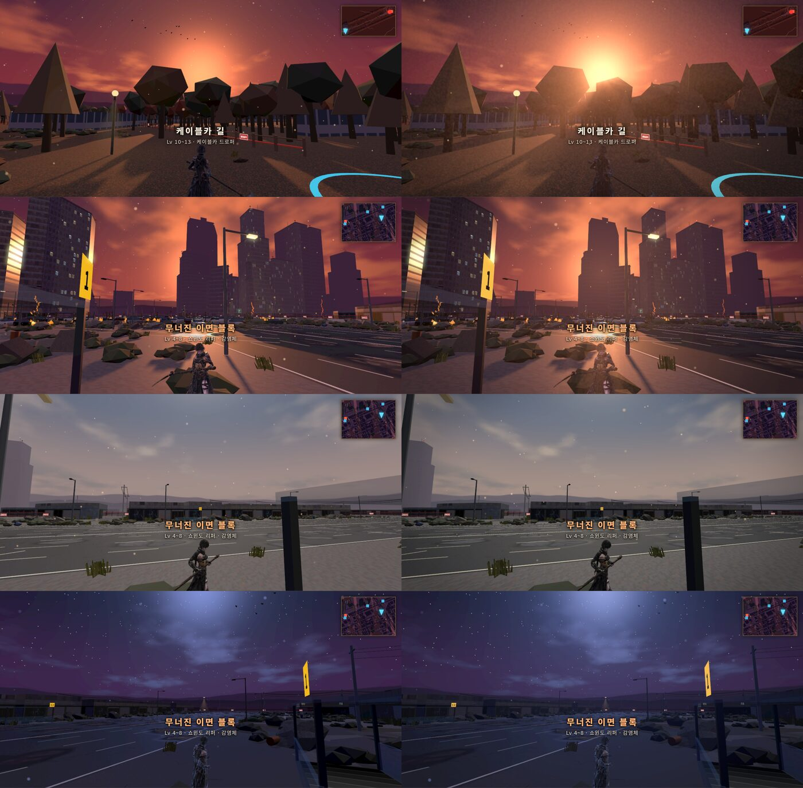

시험 `cine-post`: 해를 보면 1 · 등지면 0 · 화면 바로 밖에서도 서서히(딱 끊으면 실패) · 해가 지면 0 · 폭우 끔(빼면 실패) · NaN 이면 0(빼면 실패) · 3D 필드만 · 던전/2D 블룸 셰이더 그대로 · 밤 보정.
전체 `npm test` 1292 통과.

## 3. 게임 화면 → AI 실사화 (A) — 크레딧이 있으면

`node tools/cine-shots.mjs zones=namsan,gangnam tod=dusk` — HUD · 이름표를 숨긴 1920x1080 장면 셋(역광 낮은 각 · 4 분의 3 옆 · 내려다본 전경) + 장면마다 프롬프트(`cine-shots.json`).
이걸 힉스필드 image-to-image(키아트) · image-to-video 시작 프레임(예고편 컷)으로 넣는다. 구도는 게임이 정했으니 AI 는 «질감 · 빛» 만.
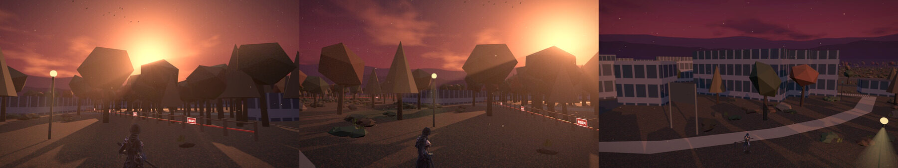

- 이 세션에 힉스필드 연결은 붙어 있으나 **크레딧 0 (plus)** — 생성은 못 했다. 크레딧이 생기면 같은 PNG 로 바로.
- 블렌더 MCP 는 «내 컴퓨터(Code → Local)» 에서만 깔린다 — 클라우드 세션에선 안 된다.
- 쓰임: ① 키아트 · 스토어 이미지 ② 예고편 ③ **룩 목표** — 실사화한 같은 구도 장면을 우리 화면 옆에 놓고 색 · 안개를 그쪽으로 당긴다(재서 견줄 기준이 생긴다).

## 4. 버려진 차 — 회색 상자에서 차로 (디렉터 «자동차랑 이런 것도 해»)
영상 A 썸네일의 주유소 · 로라이더를 보고 우리 차를 당겨 찍으니: 옆모습을 그대로 민 덩어리 하나 + 원기둥 바퀴 넷 — **바퀴가 몸 속에 파묻히고**, 불빛 · 범퍼 · 창 테두리가 없어 회색 상자로 읽혔다. 버스 · 화물차는 초록 상자.
`js/mmo/car-kit.js` `buildCar(THREE, type, R, {wreck})` — 세단 · SUV · 경차 · 화물차 · 버스:
- 몸: 바퀴 자리를 둥글게 파낸 옆모습(허리선까지) + 유리 집 + **칠한 지붕 판**(유리가 위로 떠 보이지 않게) · 앞뒤 범퍼 · 그릴 · 전조등 · 미등 · 번호판 · 사이드미러 · 타이어 + 휠
- 낡음(셰이더 하나): 위를 보는 면에 먼지 · 아래쪽 흙때 · 녹 점 — 세계 좌표만 써서 합쳐도 그대로
- 상태: 멀쩡 · 펑크(차 길이 축으로 기움, 14 %) · 탄 차(그을음 · 유리 없음 · 휠로 주저앉음, 6 %) · 폐차장(어둡고 녹 많이)
- **재질 넷**(칠 멀쩡 · 칠 낡음 · 유리 · 부품)에 색은 꼭짓점 색으로 굽는다 — 처음엔 색 · 부품마다 재질이라 그리기 호출이 강남 +44 · 여의도 +61 · 대전 +75 였다.
- 모양 난수는 차 자리 해시 — 장면 난수 R 을 더 쓰지 않아 뒤에 놓이는 것들 자리가 그대로. 2D 굽기(VIEW3D 아님)는 옛 차 그대로.
- 두 곳에서 차를 만든다: 필드 지역 `env-lib` `cars()` · OSM 지역(강남 · 여의도 …) `env-osm` — 둘 다 바꿨다(처음엔 한쪽만 바꿔 강남 화면이 그대로였다).
- 검수 `tools/3d/car-sheet.html` — 종류 × 상태. 차 한 대 ~650 삼각형(버스 ~430) — 처음 ~790 에서 바퀴 마디 · 바퀴집 곡선 · 유리 모서리 깎기를 줄였다.

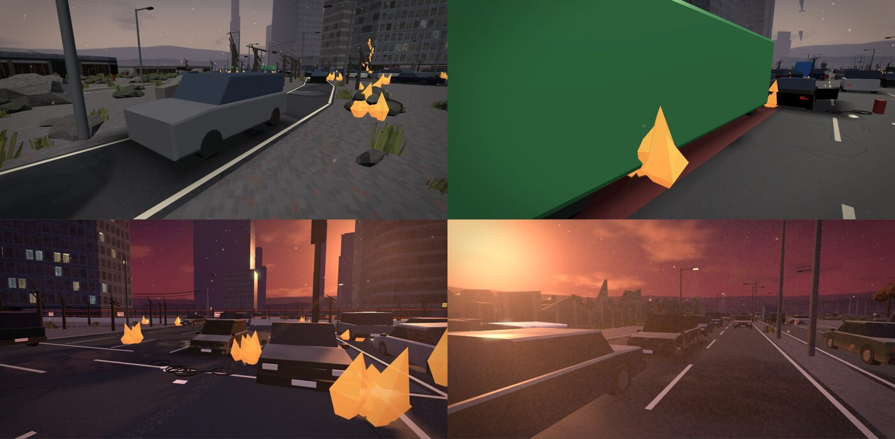
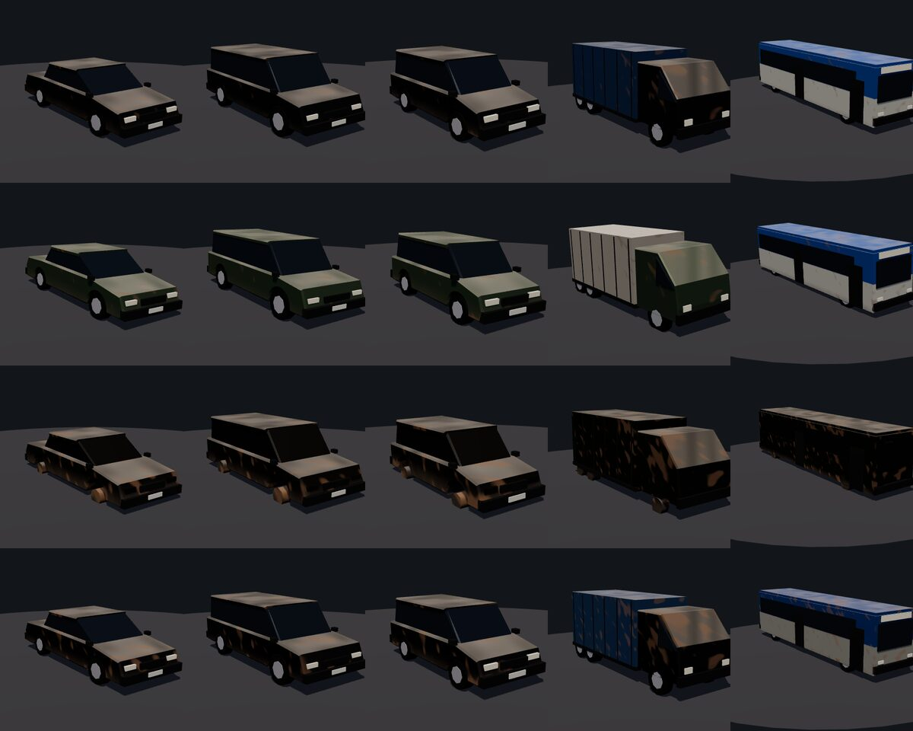

시험 `car-kit`: 삼각형 예산 · 바퀴가 땅에 닿고 바퀴집 자리(파묻으면 실패) · 탄 차 타이어 없음(남기면 실패) · 재질 4 개 이하(공유를 끊으면 실패) · 자리 해시 난수.

## 5. 버려진 주유소
`js/mmo/gas-station.js` — 캐노피(한 모서리 내려앉음 · 떨어져 매달린 천장 판 · 셋 중 하나만 살아 있는 천장 등) · 기둥 넷 · 주유섬 둘(주유기 둘씩 · 늘어진 호스 · 가끔 쓰러진 주유기) ·
가게(깨진 유리 · 처마 · 바닥 유리 조각) · 가격 기둥(숫자 꺼져 «- - - -») · 기름 얼룩 금 간 바닥판 · 두 주유섬 사이 버려진 차 · 타이어 더미 · 기름통.
**상표는 넣지 않는다** — «셀프 주유소» 와 가격판만(실제 회사 흉내 금지, 시험이 막는다).
- 자리: 거리 꾸미기(`street`)에서 큰길 옆, 18×15 m 터 전체가 걷는 띠 안 · 건물 · 물 · 차도 밖이고 막이에서 12 m 넘게 떨어진 첫 자리에 지역마다 하나. 대전 · 강남 · 여의도에 섰고 해운대는 빈 터가 없어 없음.
- 막이 열 개(기둥 · 주유섬 · 가게 · 가격 기둥 · 통 · 차)를 세계 좌표로 돌려 넣어 영웅이 뚫고 지나가지 않는다.
- 검수 `tools/3d/gas-sheet.html` · `window.__W3D.gas` 가 자리.

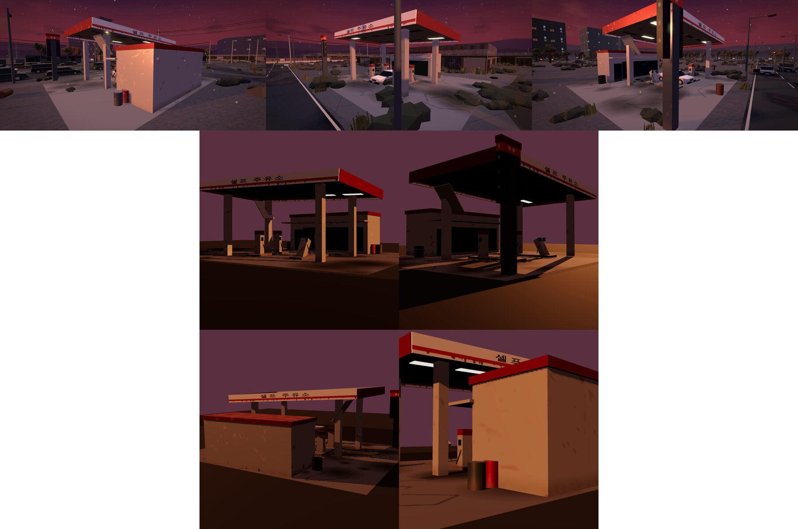

시험 `gas-station`: 터 안 · 막이 · 상표 없음 · 재질 수(꼭짓점 색 굽기를 빼면 실패) · 띠 안 검사(빼면 실패) · 막이 돌리기 = 메시 돌리기(부호를 바꾸면 실패).

## 6. 높이 안개 — 땅 · 골짜기에 깔리는 안개
`js/mmo/height-fog.js` — three 공용 안개 조각을 고쳐 모든 표준 재질 + 안개 쓰는 사용자 셰이더(연기 · 먼지 · 물거품)에 함께. 밀도 k·exp(−y/H) 를 카메라→점 광선으로 닫힌 꼴 적분, 선형 안개와 합친다.
세계 높이는 `dot(viewMatrix[1].xyz, mvPosition.xyz) + cameraPosition.y` — 사용자 셰이더엔 `transformed` 가 없어서.
- 처음 두 번은 **켜도 안 보였다** — 셰이더엔 들어가 있었다(프로그램 52 중 35). 재 보니 해 질 녘 안개색이 선형 (0.04, 0.016, 0.04) 로 거의 검정이라 땅 (69,51,51) ↔ 안개 (73,54,57), 밀도를 0.04 → 0.07 로 올려도 픽셀이 똑같았다(이미 상한).
  → 깔린 안개 색을 **밝기 0.12 쪽으로**(안개색 × 1.2~5 배) — 해 질 녘 라벤더, 밤 푸른 달빛 안개, 낮은 먼 안개보다 조금 밝게. 상한 0.75.
- 짙기(지역): 기본 0.012 · 남산 0.018 · 계룡 · 춘천 0.02 · 바다 지역 0.015, H 5 m. `?hf=0` 끔 · `?hfk=` · `?hfh=`. 3D 필드만.

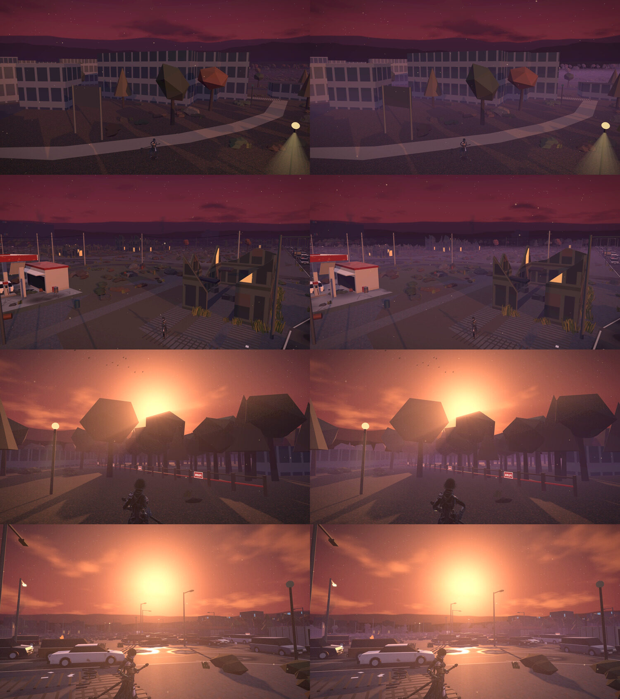

시험 `height-fog`: 낮을수록 짙고 60 m 꼭대기는 맑다(부호를 뒤집으면 실패) · 영웅 6 m 거의 안 가림 · dy→0 이어짐 · 조각에 한 번만 · 사용자 셰이더용 mvPosition 식(transformed 로 바꾸면 실패).

## 7~10. 나무 · 바위 · 건물을 사실같이 (디렉터 «나무 바위 건물도 언리얼로 좀 사실같이» · «그동안 올린 영상에 참고할만한게 있을거야»)
황혼은 **안드로이드 앱**이다(Capacitor 껍데기가 `hukkle-hub.github.io/hwanghon/` 의 3D 필드를 띄운다 — 그래서 여기 배포가 곧 앱 반영). 언리얼 프로젝트(`ue/HwanghonCombatUE`, 문서 200)는 이 컨테이너에서 컴파일·렌더를 못 하므로, 지금 앱이 실제로 그리는 3D 필드(`world3d.html`)를 **언리얼 급 방식으로** 바꿨다. 같은 사진 스캔·잎 카드 규칙은 UE 쪽 재질로도 그대로 옮길 수 있다(아래 «남은 것»). 참고: 문서 133 에 디렉터가 남긴
«Creating an Environment in UE5 using Megascans» (ExS7LzrkdQ8) · Quixel «Realistic Construction Site in UE5» (wNMHF3jGXtw) — 요지는 **사진 스캔 질감 + 낡음(데칼) + 형태 깨기(모듈 반복 없애기)**.

### 7. 잎 카드 나무 — `js/mmo/tree-kit.js`
다면체 덩어리(면마다 색이 달라 장난감) → SpeedTree · 언리얼 방식 **잎 카드**: 잎 수백 장을 그린 알파 잘라내기 판을 갓 꼴로 36 장, 노멀을 갓 중심에서 바깥으로 휘어 덩어리 음영.
소나무는 처진 가지 카드 6 층 38 장(처음 3 층은 «접시» 였다). 삼각형은 옛 갓 80 과 비슷한 72~76. 그림자도 잎 모양(알파). 남산은 나무를 따로 만들어(`env-namsan`) 같이 바꿨다 — 처음엔 빠져 남산 화면이 그대로였다.

### 8. 바위 — `js/mmo/rock-kit.js`
20 면 다면체를 한 번 쪼갠 «깎은 보석» → 180 면 공을 세 겹 잡음(셋째는 접은 잡음 — 각진 결)으로 부풀리고 칼로 자른 면 셋(층리) · 바닥 눌러 앉힘 · 꼭짓점을 합쳐 부드러운 노멀 · 움푹한 곳 어둡게.
셰이더: 사진 바위 세 방향 투영(색 + 노멀) · 윗면 이끼 · 밑동 흙 · 군데군데 가는 금. 처음엔 매끈한 조약돌(분홍) → 금이 지도 등고선처럼 고르게 → 가늘게 군데군데로.

### 9. 건물 낡음 — `js/mmo/facade-shader.js`
창 다음 단계에 «빗물 자국»(창턱 아래로 번져 흐른 폭 ~0.9 m 검은 줄 — 처음엔 1 px 긁힌 선) · 밑동 흙때 · 맨 아래 이끼 · 깨진 창 위 그을음. 세계 좌표만 써서 합쳐도 그대로. 벽돌 빌라는 따로라 아직.

### 10. 사진 스캔 텍스처 — Poly Haven (CC0) · `js/mmo/ph-tex.js` · `art/tex/ph/`
Megascans 는 언리얼 전용 사용권이라 같은 급의 **CC0(공개 도메인)** 사진 스캔을 썼다: 바위 `rock_boulder_dry` · 나무껍질 `japanese_zelkova_bark`(느티나무) · 벽 `concrete_wall_006`.
색 · 노멀 · 거칠기 512 px(휴대폰) — 합 670 KB. 사진 평균 밝기를 1 배로 맞췄다(처음엔 바위 · 줄기가 검었고, 다음엔 줄기가 자작나무처럼 하얬다). 사진이 아직 안 왔을 때 검게 찍히지 않게 시트는 다 받고 그린다.
`?tc=0` 이면 옛 나무 · 바위 · 벽.

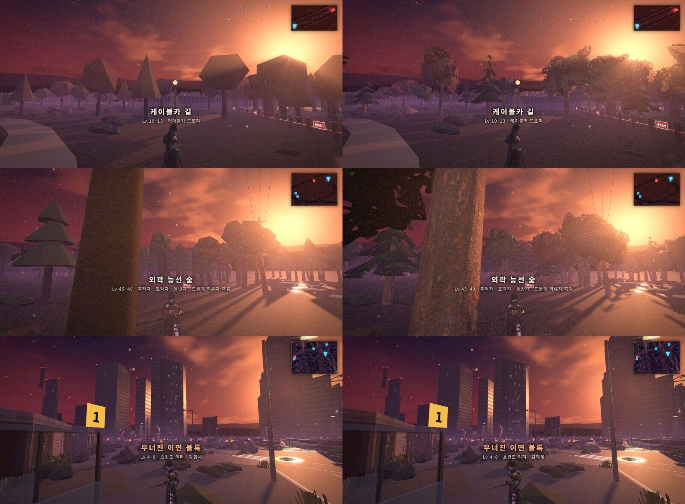
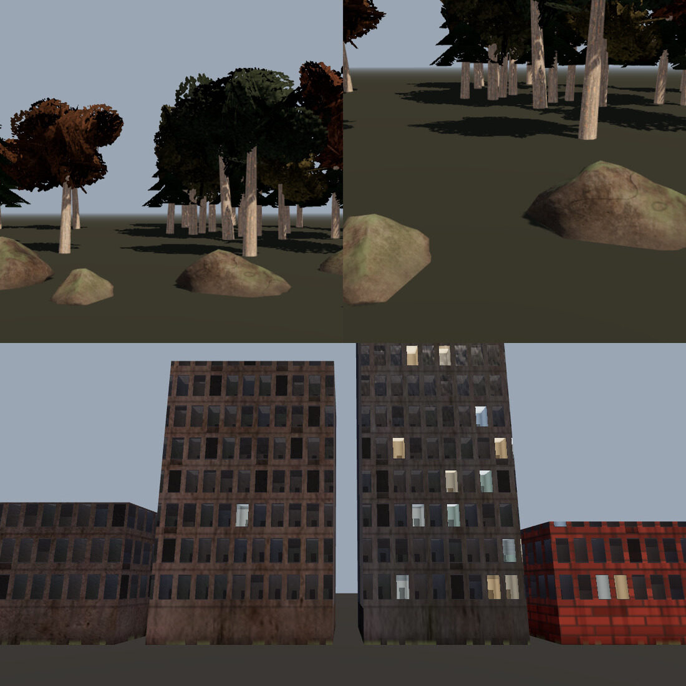

시험 `realism-kit` · `world3d-natural`: 카드 장수 · 소나무가 원뿔(접시면 실패) · 바위 노멀 부드러움(꼭짓점 안 합치면 실패) · 셰이더 전처리 줄(«#endif 코드» 붙으면 실패 — 실제로 한 번 셰이더가 안 만들어졌다) · CC0 · 512 px · 용량 · 낡음 끄면 다른 프로그램 · 남산도 카드(빼면 실패).

### 11. 빌라 벽돌 · 무너진 건물 · 아스팔트 · 덤불 — 사진 스캔 다섯 장 더
같은 Poly Haven CC0, 512 px · 색과 노멀만(거칠기는 재질 값 하나 — 휴대폰에서 한 장이라도 덜 읽게). 여덟 장 합 1.1 MB.

| 대상 | 사진 (한 장 크기) | 고친 것 |
|---|---|---|
| 붉은 벽돌 빌라 | `red_brick` (1.4 m) | 처음 색을 (0.95, 0.55, 0.5) 로 누르니 회색 줄눈까지 빨개져 벽돌 무늬가 사라졌다 → (0.92, 0.7, 0.68) |
| 갈색 벽돌 빌라 | `brick_wall_10` (1.9 m) | 사진이 아주 어두워(선형 0.05) 옛 캔버스 평균에 맞춰 ×3 |
| 무너진 건물 벽 | `concrete_layers` 거푸집 콘크리트 (1.55 m → 3.1 m 로 늘림) | 옛 벽은 **유리창이 그려진** 캔버스라 부서진 토막에도 불 켜진 유리가 붙어 있었다. 이제 창은 «뚫린 구멍»(3.3 m 층 × 3 m 칸, 둘레 깨진 테 · 위 그을음 · 밑동 흙때). 옛 바탕색(청 · 자색)을 곱하니 보랏빛 벽이라 회색으로. 1.55 m 마다 같은 띠가 판자벽 같아 두 배로 늘렸다 |
| 잔해 더미 | `concrete_debris` (2 m) | 캔버스 자갈 무늬 대신 |
| 길 (강남 · 남산 · 다른 도시 셋 다) | `asphalt_02` 금 간 아스팔트 (3 m, 3.5 m 에 한 장) | 3 m 사진을 수백 m 에 깔면 같은 금이 줄지어 멀리서 «마룻바닥». 37° 돌려 한 번 더 읽어 섞는 방식은 섞인 곳만 깨지고 금줄 격자는 그대로였다 → **IQ «texture repetition» 3번**: 값 잡음으로 칸마다 다른 밀어 읽기 둘을 골라 섞는다(`ph-tex.js antiTile`, textureGrad 로 밉맵 끊김 없이, 노멀도 같은 섞음). 읽기 +2 번. 웅덩이 속에선 노멀을 지운다(물낯은 판판) |
| 덤불 | 사진 아님 — 잎 카드 24 장(`tree-kit leafBushGeo`) | 강남 길가 덤불이 짙은 다면체라 **각진 바위로 읽혔다**(디렉터 화면 첫 줄에 있다). 나무 잎 판은 잔가지가 코앞 검은 빗금이라 덤불 전용 잎만 그린 판 |

장면 난수 · 막이는 그대로(시험). `?tc=0` 이면 전부 옛것.

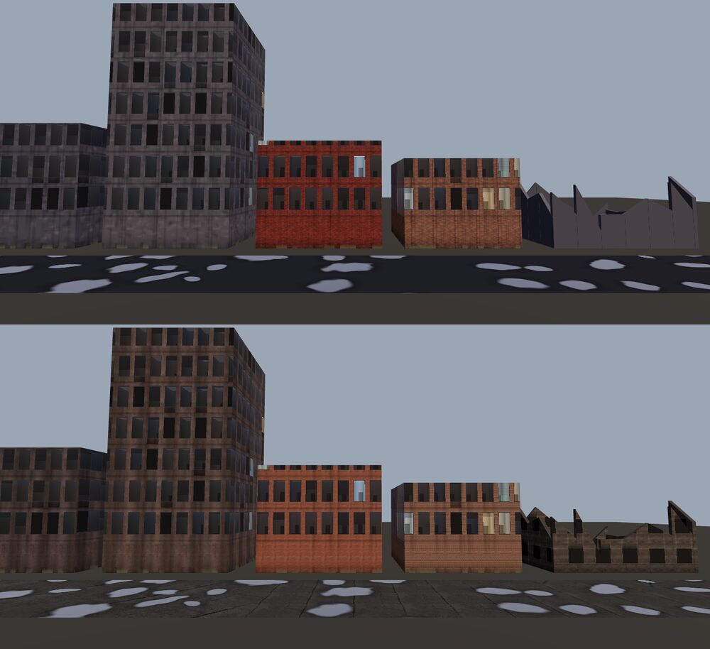
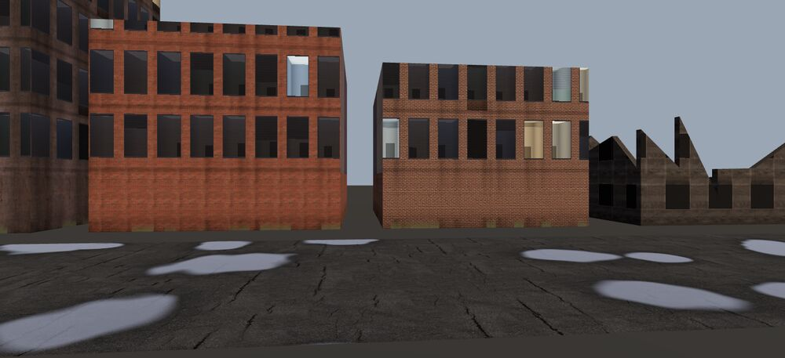
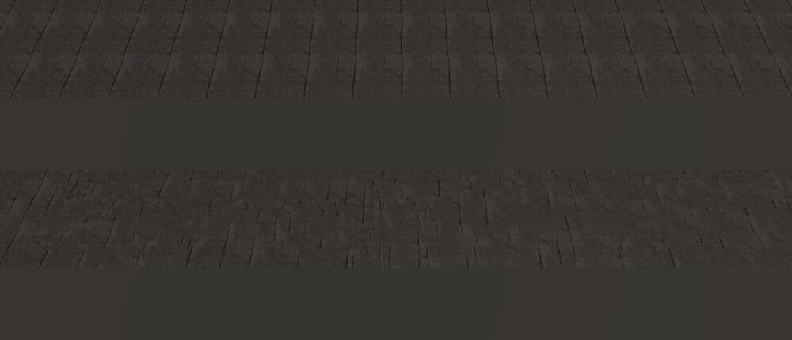
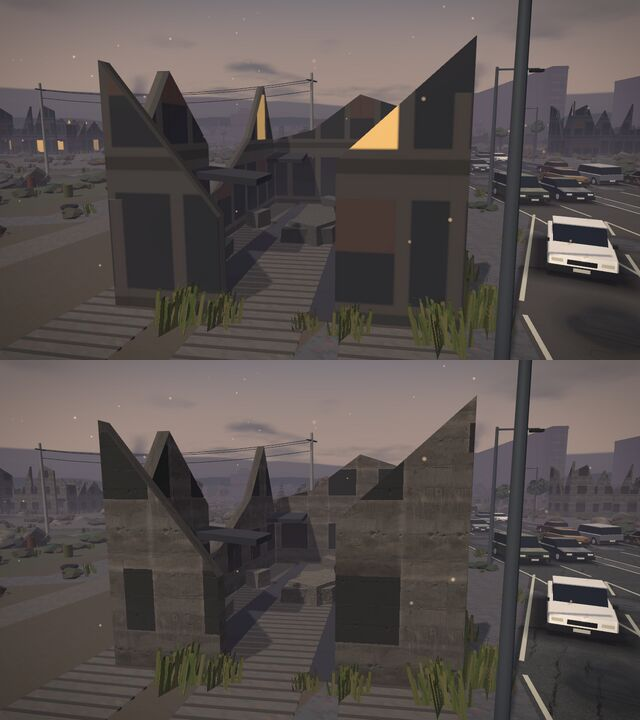
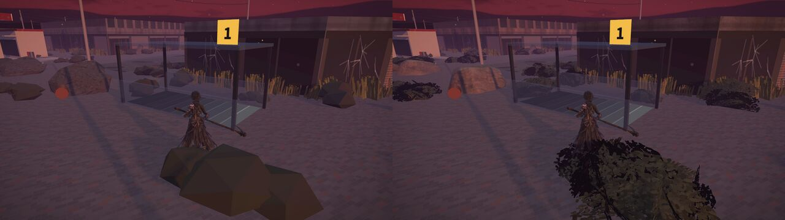

시험: 사진 여덟 장 CC0 · 512 px · 1.2 MB 아래 · 길 찾기 시험이 사진 아스팔트도 길로 보게 · 덤불이 잎 카드(표시 지우면 실패 — 일부러 깨 봄).

### 12. 땅 — 보도블록 · 풀밭 · 숲 바닥 · 모래 · 흙길
사진 다섯 장 더(CC0 · 512 px · 색 + 노멀): `concrete_pavers` 맞물림 보도블록(1.92 m) · `sparse_grass` 웃자란 풀(2 m) · `forest_leaves_02` 낙엽 · 이끼(3 m) · `dense_sand`(1.8 m) · `forest_ground_04` 흙길(3.15 m).
주차장 · 공업지(옛 «콘크리트»)는 한국 주차장답게 §11 아스팔트를 밝게. 색은 옛 캔버스 평균(선형)에 맞췄다 — 보도 0.07 · 풀 0.03 · 숲 0.04 · 모래 0.13 · 흙길 0.15.

- 쓰는 곳: 땅 한 장(다른 도시 · 강남 · 남산) · 땅 쓰임(풀밭 · 모래 · 숲 · 주차장) · 보행로 · 얼룩 · 강남 공원 · 남산 흙길 · 보도. `env-lib groundPhoto(kind)` 하나로.
- 넓은 판이라 전부 §11 반복 깨기. **함정:** world3d 의 «땅 결 · 구름 그림자» 패치가 `#include <map_fragment>` 뒤에 붙는데, 반복 깨기가 그 줄을 펼쳐 버려 사진 땅에서만 결 · 구름 그림자가 사라질 뻔했다 → 반복 깨기가 표지 `/*@map_fragment*/` 를 남기고 땅 결이 표지에도 붙는다(시험 — 표지를 지우면 실패, 일부러 깨 봄).
- 사진 열세 장 합 1.7 MB(한 지역은 그중 일부만 받는다).

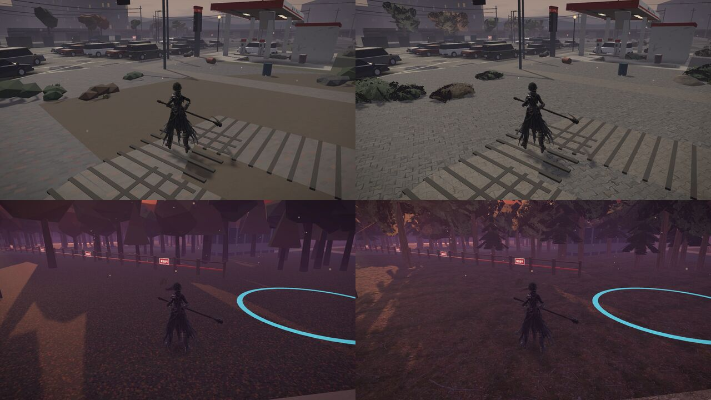
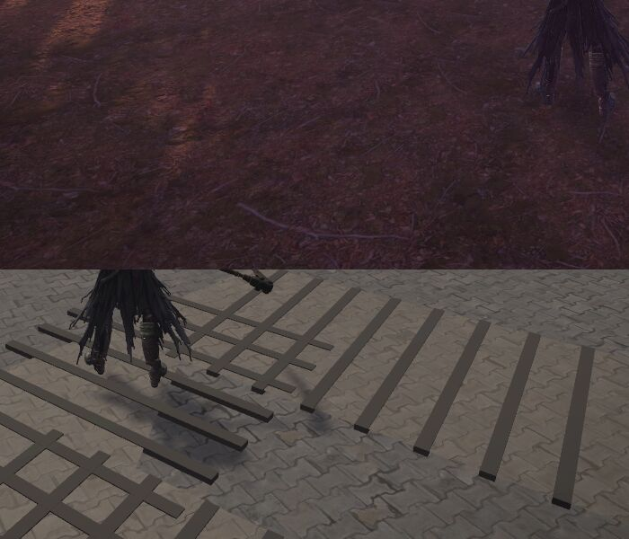
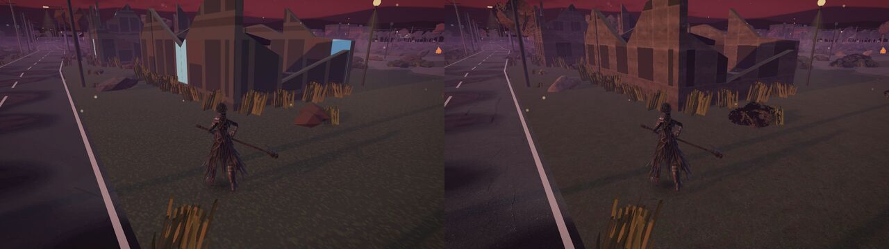

### 13. 바람 — 들판을 건너가는 돌풍 · 같이 휘는 줄기와 갓 · 잎 떨림 · 날리는 잎 (`js/mmo/wind.js` · `wind-leaves.js`)
엘든 장면의 «바람이 보이는» 맛. 옛 바람은 갓 인스턴스를 통째로 밀어서 줄기 위에서 미끄러졌고, **남산 숲은 바람이 아예 없었다**(나무를 따로 짓는다).

- 돌풍: 바람 방향으로 ~9 m/s 로 건너가는 큰 물결(세기 0.25~1). 나무 · 덤불 · 풀포기가 같은 식이라 무리가 차례로 눕는다.
- 휨: 세계 높이²(5 m 기준) — 줄기 · 갓에 같은 식을 세계 공간(인스턴스 뒤 · 뷰 앞, `project_vertex` 를 바꿈)에서 더하니 같은 높이는 같이 움직인다. 5 m 에서 돌풍 때 ~0.3 m.
- 잎 떨림: 잎 카드 꼭짓점마다 빠른 작은 떨림 — 돌풍이 지날 때 커진다(줄기 0).
- 날리는 잎: 카메라 앞 24 × 8 × 24 m 상자에 잎 90 장(휴대폰 60). 자리 · 흐름 · 돌기 · 상자 감싸기가 전부 정점 셰이더 — CPU 는 매 프레임 카메라 자리 하나, 그리기 1 번. 처음엔 11 cm · 36 m 상자라 게임 화면에서 안 보였고(시트에선 보였다), 코앞 잎은 흐릿한 검은 원판이라 3.5 m 안에서 줄인다. `?leaves=0` 으로 끔.
- 그림자 깊이 재질엔 안 붙인다(그림자는 그대로 — 휴대폰 값).

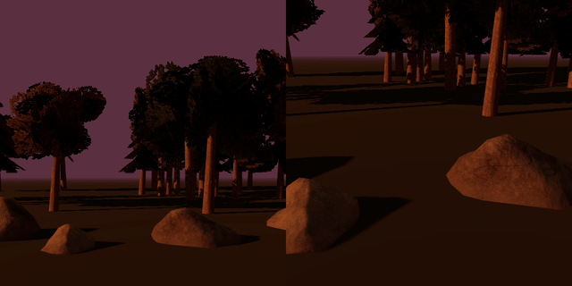
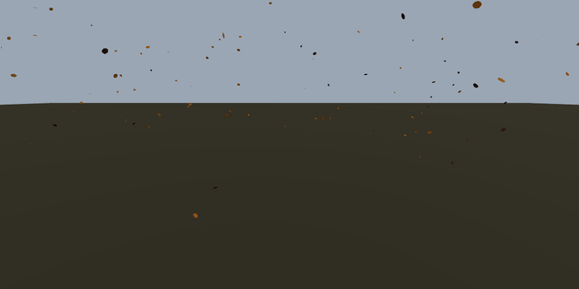
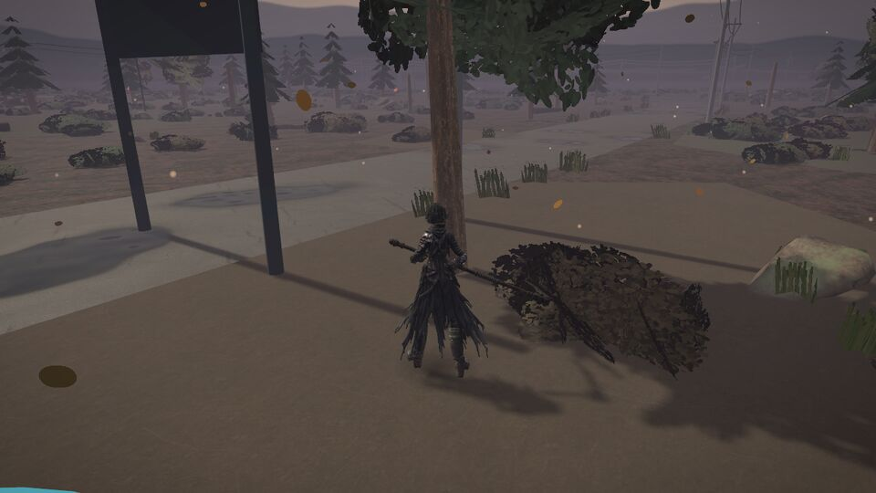

시험: 돌풍이 시간에 따라 움직임(시간 항을 지우면 실패 — 일부러 깨 봄) · 높이² 휨 · 줄기 바람(떨림 0) · 세계 공간 · 잎 상자 감싸기 · 그리기 1 번.

### 14. 날씨 — 비 (`js/mmo/weather.js` · `rain.js` · 웅덩이 · 땅 결)
엘든 장면의 «비 온 뒤 젖은 들판 · 회색 하늘». 날씨 체계가 아예 없었다.

- 일정: 시간대와 같은 서버 시각 — 같은 필드는 같은 비. 18 분 칸마다 존 씨앗 해시로 약 28 % 가 비, 칸 경계 75 초 동안 서서히 오고 그친다. 그친 뒤 땅은 몇 분에 걸쳐 마른다(12 분이면 다 마름). 장면 난수 · 막이 · 서버는 그대로.
- 하늘 · 빛: 시간대 결과에 얹는다 — 하늘 · 안개 · 반구광은 잿빛(채도 60 % 빼고 22 % 어둡게), 해는 구름 뒤로(세기 −75 %, 해 둘레 빛 −85 %), 빛줄기 · 해 둘레 번짐도 줄인다. 안개가 가까이(먼 쪽 −30 % — 걸러내기가 더 일찍 잘라 휴대폰엔 오히려 가볍다).
- 빗줄기: 카메라 앞 상자에 가는 줄 700 개(휴대폰 350) — 떨어짐 · 바람 기울기 · 감싸기가 정점 셰이더, 그리기 1 번, 세기만큼만 남긴다. 처음엔 너무 옅어(폭 1.2 cm · 알파 0.32) 안 보였다 → 1.8 cm · 0.55, 밤에도 보이게 바닥 밝기.
- 젖은 땅: 모든 땅 판(땅 결 패치)이 젖음만큼 어둡고 덜 거칠어진다 — 고르게가 아니라 9 m 얼룩. 낮엔 거칠기 0.45 아래로 안 간다(낮은 해 하얀 번짐, 문서 217 §2), 밤엔 0.25 까지(가로등 번짐).
- 웅덩이: 비 오면 넓어지고(젖음 × 0.3), 빗방울 동심원(31 cm 칸 두 겹)이 법선 · 주변 비침을 흔든다.
- `?wx=rain|clear|wet` 로 촬영 · 견주기. 소리는 아직 — 합성음은 디렉터가 반려했다(`js/sfx.js`), 실제 녹음(CC0)이 있어야 한다.

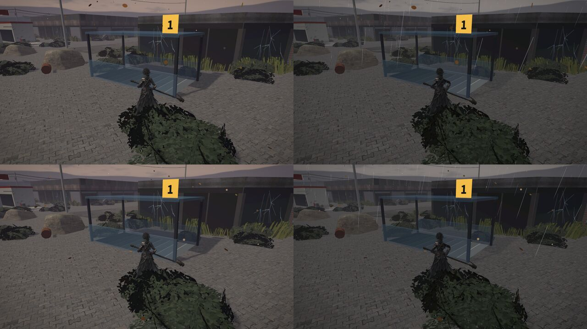
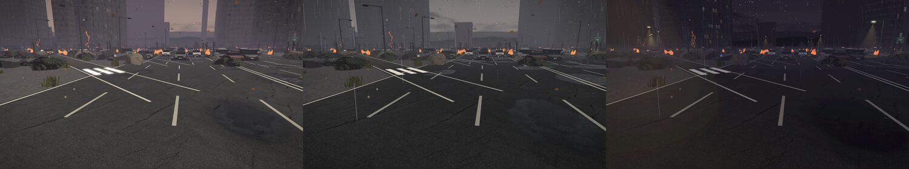
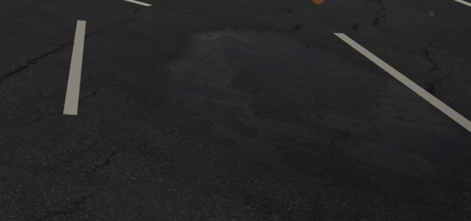
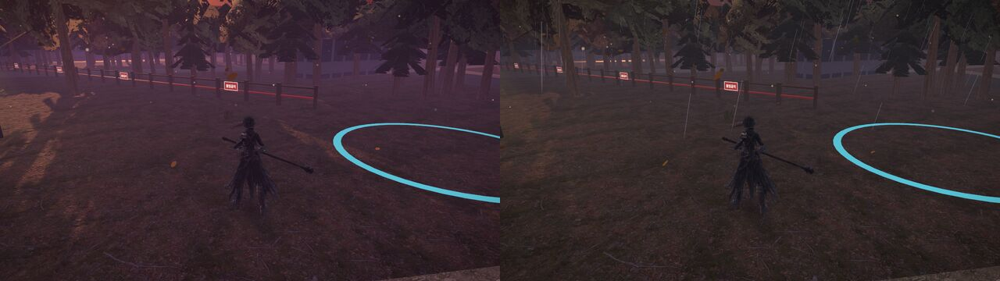

시험 `weather`: 같은 존 · 시각이면 같은 비 · 비율 20~36 % · 6 초에 0.1 넘게 안 뛴다(경계 75 초를 1 초로 줄이면 실패 — 일부러 깨 봄) · 그친 뒤 마름 · 잿빛 · 빗줄기 셰이더 · 웅덩이 · 젖은 땅 낮 하한.

### 15. 짙은 안개 · 젖은 벽 · 물 튀김
- **짙은 안개 날씨**: 칸마다 14 % (비와 겹치지 않는다). 엘든 림그레이브 아침 숲 — 하늘 · 안개를 밝은 잿빛으로, 해는 반쯤 가리고 반구광을 올려 대비를 낮춘다. 안개가 앞으로 0.28 배 당겨지고 **땅에 깔린 안개(§6)가 그만큼 짙어진다** — 깔린 안개 값은 `#define` 으로 굽혀 있어서, three 가 모든 재질에 이미 넘기는 `fogNear` 로 전한다(`n0 / fogNear`, 1~4 배; 지수 안개엔 fogNear 가 없어 막아 둠). 빛줄기 ×2.3 · 해 둘레 번짐 ×1.9 — 해를 마주 보면 안개 사이로 빛기둥. 이슬로 땅이 조금(0.35) 젖는다.
- **젖은 벽**: 건물 벽(가짜 실내 창 재질)과 무너진 콘크리트가 비 · 젖음만큼 어둡고(−26 %) 덜 거칠어지고, 빗물 자국이 짙어진다. 유리는 그대로.
- **물 튀김**: 카메라 앞 땅에 작은 고리 220 개(휴대폰 120), 방울마다 0.3 초 살이 · 살이마다 새 자리. 처음엔 높이 0.03 m 라 **길 윗면(0.06 m) 밑에 묻혀** 게임 화면에서 하나도 안 보였다(시트에선 보였다 — 시트엔 길이 없다) → 0.1 m. 그다음 굵고 밝은 고리는 «길에 칠한 흰 도넛» 이라 옅게.
- 촬영 도구 `cine-shots` 의 `q=wx=mist` 가 첫 `=` 아닌 모든 `=` 에서 잘려 날씨가 안 붙었다 — 고침. 비 · 튀김 시트 `tools/3d/rain-sheet.html`.

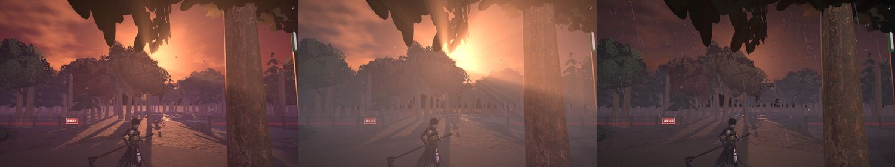
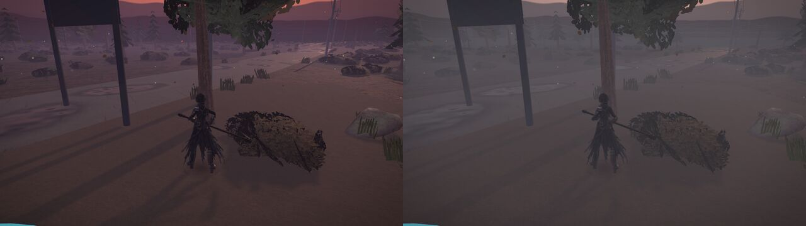
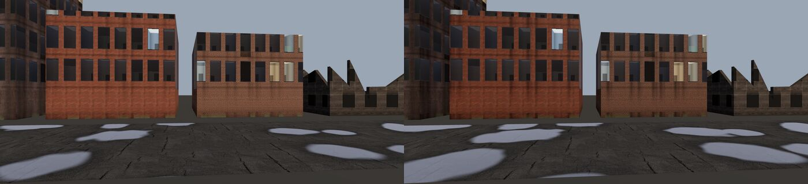
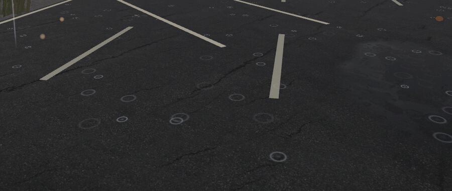

시험: 안개 비율 8~20 % · 비와 안 겹침 · 밝은 잿빛 · 깔린 안개가 fogNear 로 짙어짐 · 빛줄기 · 젖은 벽 · 튀김 살이.

### 16. 밤하늘 — 달 · 은하수 · 별똥별 (`js/mmo/sky-shader.js`)
별(문서 220 §13)은 있었지만 달이 없었다. 시간대는 밤에 «해» 방향으로 달빛을 넘긴다 — 그 자리에 달 원반: 위상 그늘 · 얼룩(바다) · 둘레 달무리. 처음 밝기(1.35)는 밤 노출 1.75 · 번짐에 하얀 덩어리라 0.42 로 — 위상이 보인다.
은하수는 하늘을 비스듬히 가로지르는 옅은 띠(먼지 갈래 fbm), 별똥별은 약 20 초에 한 번 0.6 초. 셋 다 밤(윗하늘 밝기로 잰 dark)에만, 구름에 가린다. 밤엔 해 둘레 번짐을 달무리가 대신한다.
비 · 안개 날씨엔 구름이 하늘을 덮는다(cover 0.5 → 비 0.12) — 비 오는 밤에 별이 보이면 안 된다.

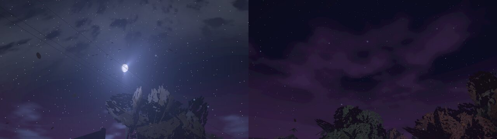
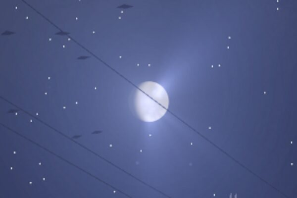

### 17. 바다 — 너울 · 해 길 반짝임 · 마루 청록 · 비 동심원 (`env-lib waterMat`)
물(문서 220 §6)은 잔물결 · 하늘 비침 · 해 한 점 반짝임만 있어 «잔잔한 호수» 였다. 웅덩이(calm)엔 안 붙이고 바다 · 강에만:
- 큰 너울(약 25 m, 두 방향) 기울기를 잔물결에 더한다 — 넓은 명암 띠가 천천히 밀려온다.
- 해 길 반짝임: 20 cm 칸마다 작은 점이 깜빡이고, 해 쪽으로 모인다(pow 18). 처음엔 칸을 통째로 켜서 **네모 타일**이었다 → 칸 안의 점. 안개 · 비엔 줄인다.
- 해를 마주 보면 물결 마루로 청록 빛(빛이 물결을 뚫는 맛) — 처음 값은 띠가 너무 파래 0.35 로.
- 비가 오면 수면에 빗방울 동심원.
- 견줄 때 «전 · 후» 를 동시에 돌리면 서버가 같은 파일을 줘 둘이 똑같이 찍힌다(git stash 경쟁) — 차례로 찍는다.

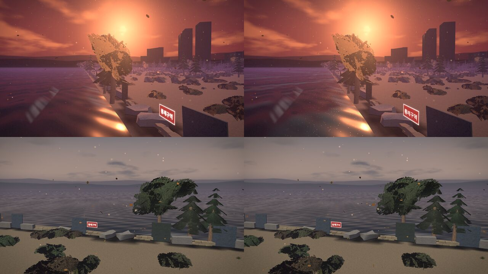
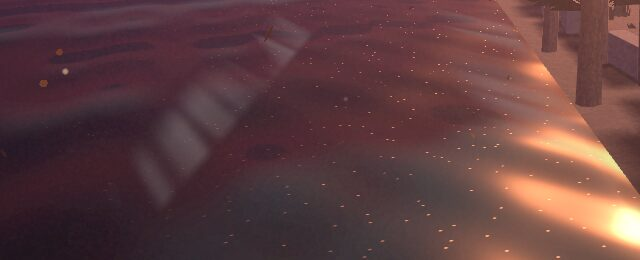

### 18. 먼 산 세 겹 · 새털구름 (`js/mmo/sky-shader.js`)
하늘 돔의 산 능선(문서 220)은 둥근 fbm 두 겹이라 «솜 언덕» 이었다.
- 가장 먼 겹(높고 옅은 봉우리, 가까운 능선의 1.32 배)을 더하고, 능선은 날 선 잡음(ridged)을 섞어 봉우리가 생긴다.
- 가까운 능선엔 나무 숲 가장자리(고주파 잡음 0.45 %) — 한국 산은 숲이다.
- 해 쪽 비탈은 밝게(방위각 기울기 × 해 방위). 처음엔 겹 전체를 위아래로 칠해 **세로 «커튼» 줄무늬** → 마루 가까이만 · 대비 낮춤.
- 겹마다 밑동은 골짜기 안개, 지평선엔 옅은 안개 띠 — 겹이 서로 떨어져 보인다. 높은 곳엔 가는 새털구름.
- 휴대폰: 산은 지평선 근처(y < 0.32)에서만 셈한다.

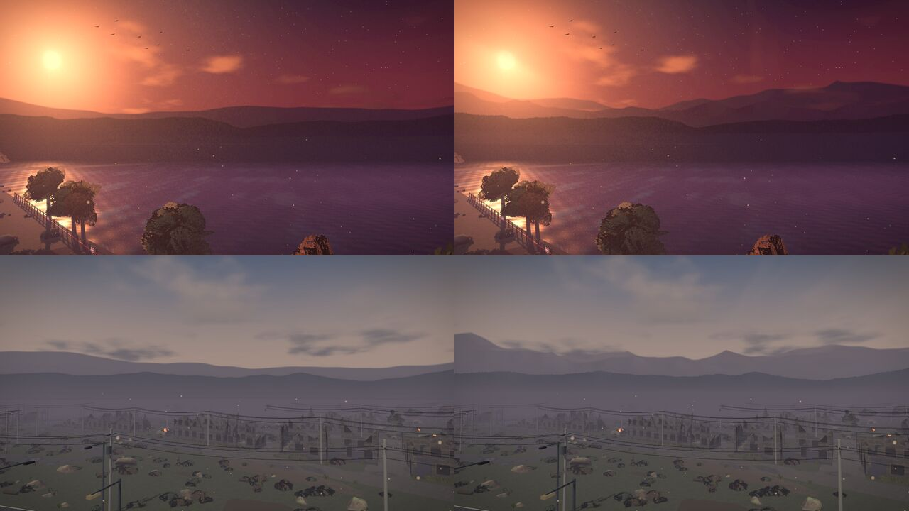
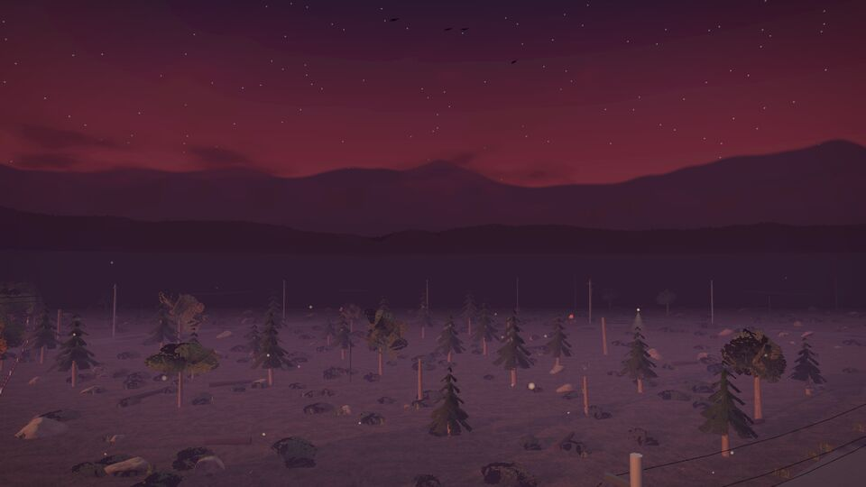

### 19. 물에 비친 산 · 구름 빛
- 물에 비친 능선(SKY_REFL)을 하늘과 같은 세 겹 · 같은 날 선 능선 · 같은 주파수로 — 강가에서 하늘 산과 물속 산이 달랐다. 비탈 명암 · 숲 가장자리는 뺀다(물결에 흩어진다). 가장 먼 봉우리보다 높이 비치는 물 픽셀은 잡음을 건너뛴다.
- 구름 빛: 해 쪽으로 조금 밀어 다시 읽은 밀도와의 차로 해를 향한 쪽은 밝게(×1.22), 반대쪽 배는 어둡게(×0.7) — 한 덩어리 회색 판이었다. 해 가까운 가장자리는 은빛 테. 구름 없는 곳은 셈하지 않는다.

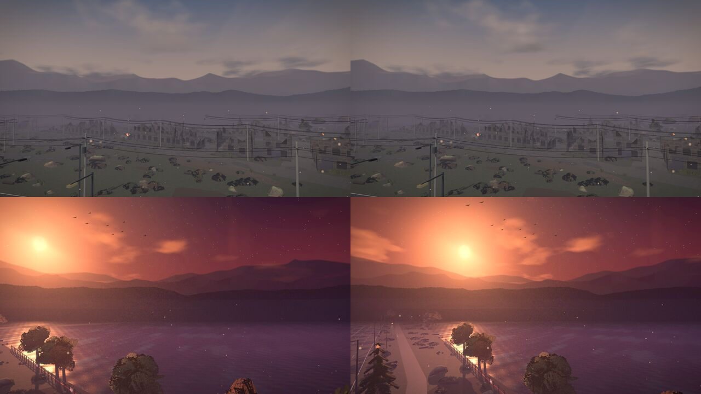

### 20. 하늘 점검 · 새벽
경주 · 속초를 새벽 · 낮 · 황혼 · 밤으로 찍어 보니(아래 첫 그림, 해 쪽) 낮(잿빛 — 의도) · 황혼 · 밤은 괜찮았는데 **새벽이 «조금 분홍인 황혼»** 이었다: 해가 26° 로 높아 지평선 빛이 없고 안개에 씻겼다.
해를 11° 로 내리고(능선 위로 막 뜬다), 위는 찬 남색 · 지평선은 더운 살구빛. 처음엔 해 둘레 빛(glow 0.7)이 번짐 · 빛줄기와 겹쳐 화면이 하얗게 날아가(속초) → 0.4 · 노출 1.5 → 1.35. 그림자가 길어져 새벽답다.

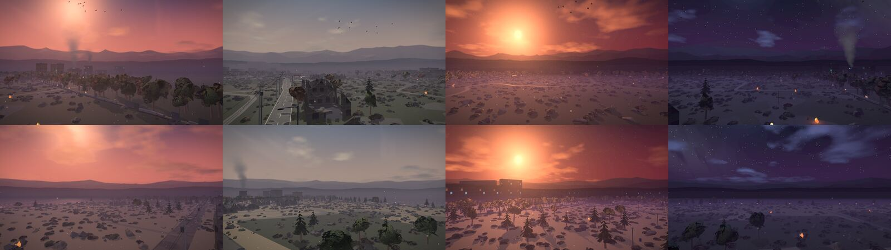
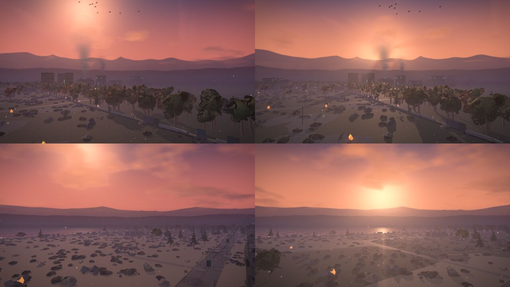

### 21. 해안 — 밀려오는 물마루 · 젖은 모래 · 합치기 버그
- 물가 거품(문서 220) 바깥으로 해변에 다가오는 흰 물마루 줄(물 쪽 3~18 m, 줄마다 휘고 잡음으로 끊김, 바깥일수록 옅게), 땅 쪽 5 m 는 파도 박자에 맞춰 들고 나는 젖은 모래(곱하기 섞기로 어둡게). 해안선(coastline)과 2 ha 넘는 물 다각형에 — 경포 · 해운대 바다는 해안선이 아니라 물 다각형이었다.
- **합치기 버그(오래된 것)**: 정적 합치기(static-merge)가 재질을 «서명»(종류 · 색 · 거칠기 · 텍스처 …)으로 묶는데, 셰이더 재질은 그 값이 다 비어 있어 **모든 셰이더 재질이 같은 서명** → 젖은 모래 · 물마루가 첫 거품 재질로 바꿔 끼워졌다. 화면엔 물 위에 커다란 «횡단보도» 줄무늬가 나왔다(색을 칠해 봐도 안 바뀌어서 찾았다 — 숨기면 사라지고, 거품 재질을 초록으로 칠하니 띠 전체가 초록). 셰이더 재질은 저마다 따로 둔다. 시험: 서명이 같은 셰이더 재질 둘이 살아남는다(되돌리면 실패 — 일부러 깨 봄).
- 거품 · 물마루는 물(앞당김 −6)보다 앞(−14)으로 — 물에 반쯤 묻혀 깜빡였다.

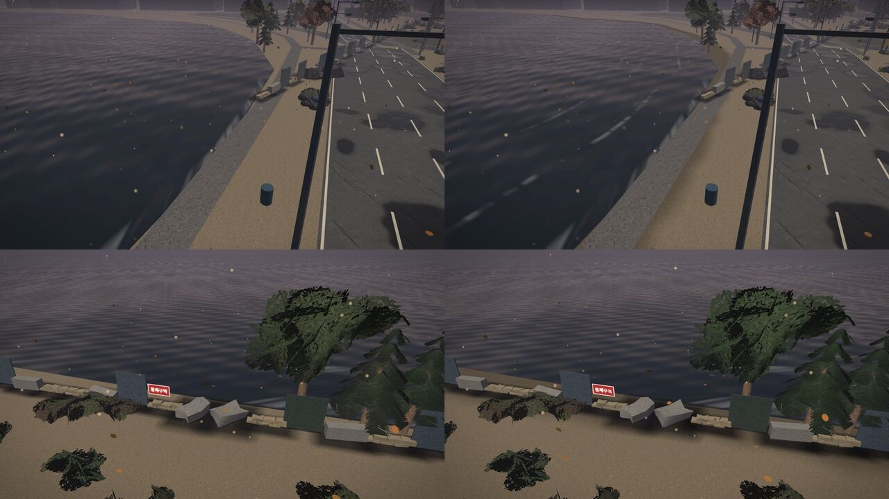
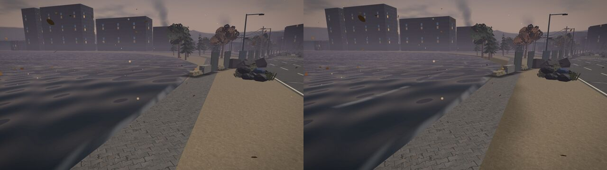

### 22. 밤 — 먼 불길 · 탐조등 · 반딧불 (`sky-shader.js` · `js/mmo/night-fx.js`)
폐허 도시의 밤은 의도대로 어둡지만(켜진 창은 생존자 블록에만) 지평선이 텅 비었다.
- 먼 불길: 밤 지평선 몇 방위에 주황 빛무리가 낮게 깔려 위로 옅어지고 일렁인다 — 도시 저편이 아직 탄다. 세기는 지역 성격(도시 1 · 산 0.25). 처음엔 능선보다 먼저 그려 **산에 가려** 주황 실선만 보였다 → 능선 뒤에.
- 탐조등: 도시 · 강 · 해안 지역에 2~3 줄, 카메라에서 140~190 m 밖에 고정 방위로 서서 천천히 하늘을 훑는다. 처음엔 위 지름 8 m 라 190 m 밖에서 안 보였고(→ 52 m), 그다음엔 세로 520 배 늘린 기둥에 `mat3(modelMatrix)` 로 법선을 돌려 **법선이 수직으로 누워 밝기 0** 이었다 → `normalMatrix`(역전치). 시험: 되돌리면 실패.
- 반딧불: 산 · 들 · 섬 · 강 지역, 카메라 앞에 노란 초록 점 90 개(휴대폰 50)가 떠돌며 깜빡인다.
- 셋 다 밤(가로등 세기)에만, 비 · 안개엔 줄인다. 그리기 1 번씩. `?nfx=0` 으로 끔.

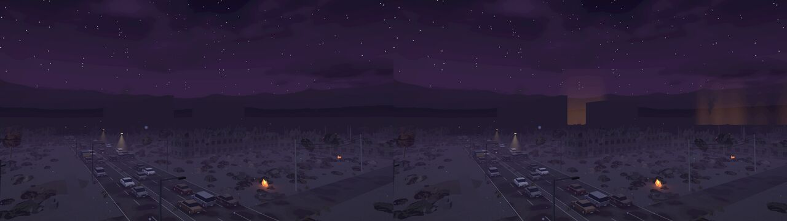
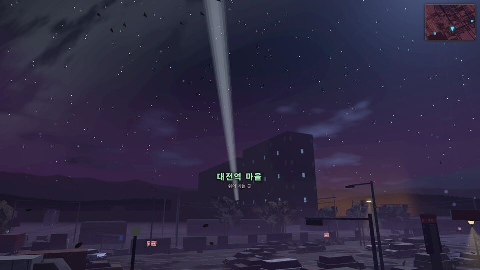
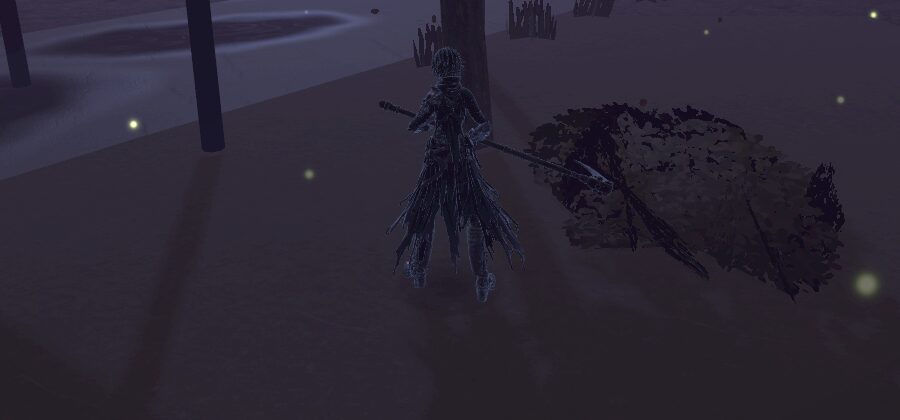

### 23. 휴대폰 무게 다시 재기 — 오늘 더한 것들
헤드리스(swiftshader, CPU 래스터)는 절대값이 폰과 다르지만 같은 화면 · 같은 크기(640 × 360)에서 **비율은 화소당 셈을 따라간다**. 오늘 작업 전(`819c012^`, 워크트리를 8778 에 띄움)과 견줬다 — 같은 조건을 두 번 재 흔들림 ±30 ms.

| 지역 (프레임 ms) | 오늘 전 | 고치기 전 | 고친 뒤 |
|---|---|---|---|
| 계룡 (숲) | 545 | 1891 (×3.5) | 1086 (×2.0) |
| 강남 | 601 | 1008 (×1.7) | 803 (×1.3) |
| 해운대 | 636 | 1074 (×1.7) | 794 (×1.25) |
| 남산 | 568 | — | 1044 |

가르기(`?tc=0` 전부 옛것 · `?tcc=0` 잎 카드만 · `?tcp=0` 사진만 · `?at=0` 반복 깨기만 · `?cine=0` 영화 후처리): 영화 후처리 · 비 · 바람 잎 · 높이 안개 · 밤 연출은 거의 0. 무게는 **잎 카드(숲)** 와 **사진 땅 반복 깨기(도시)** 였다.
- **잎 그림자**: 카드 갓을 그림자 지도에 그대로 그려 카드마다 알파 잘라내기 — 계룡 프레임의 1/3. 그림자는 옛 덩어리 갓(불투명, 화면엔 안 그림)으로. 덤불도.
- **반복 깨기**: 노멀까지 두 번 읽어 섞고 기울기 지정 읽기(textureGrad)를 썼다 — 땅 전체라 강남 프레임의 1/5. 노멀은 한 번(가까운 쪽 밀기), 색은 보통 읽기로. 반복 깨짐은 그대로(길 견주기 그림 확인), 칸 경계 2×2 화소 밉맵 튐은 안 보인다.
- 잎 카드 36 → 28 장, 잎 · 솔잎 · 덤불은 람베르(무광이라 같아 보인다) — 이 둘은 효과가 작았다(−6 %).
- **해 봤지만 버린 것**: 거리 LOD(45 · 22 m 밖은 덩어리 갓) — 빽빽한 숲에서 불투명 덩어리끼리 겹쳐 칠하는 값이 더 커서 1060 → 1850 ms. 지웠다.
- 계룡은 아직 ×2 — 남은 건 화면의 잎 카드 겹침 그 자체. 폰에서 30 fps 아래로 떨어지면 휴대폰만 카드 수를 더 줄이는 등급을 둔다.

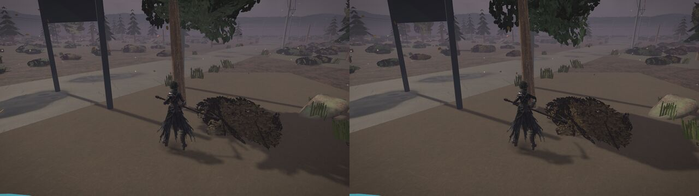

### 24. 숲 무게 더 — 그림자 대역은 그림자 층에만 · 휴대폰 잎 카드 등급
- §23 의 그림자 대역(덩어리 갓 · 덤불, 3,100 그루)은 colorWrite 만 꺼서 **화면 패스에서도 래스터**하고 있었다 — 1 번 층에만 두고 해 그림자 카메라만 1 번 층을 본다(`SHADOW_LAYER`). 계룡 1012 → 975 ms.
- 그 탓에 카드 수를 줄여도 그대로였다(1012 → 1019) — 대역을 치우니 비로소 효과가 났다: 휴대폰 등급(`CARD_TIER.lite`, 터치 기기 또는 `?lite=1`)에서 갓 28 → 20 장(조금 키움) · 덤불 24 → 15 · 소나무 38 → 26. **계룡 842 ms** (오늘 전 545 · 처음 1891).
- 그림자 · 나무 모양 확인: 아래 그림 왼쪽부터 처음 · 데스크톱 · 휴대폰 등급.

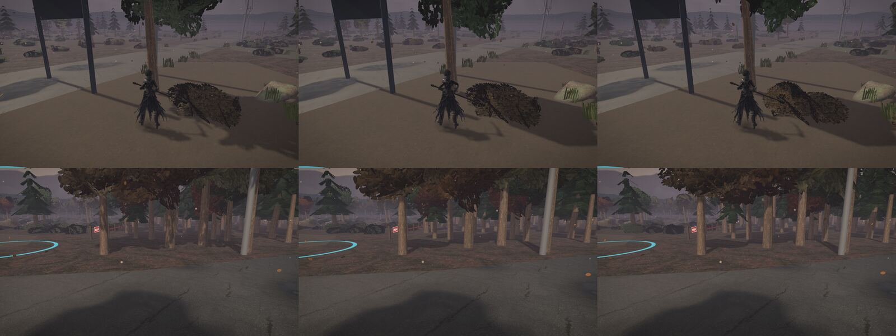

## 남은 것
- 빗소리(CC0 녹음) — 합성음은 반려됨.
- 언리얼 프로젝트(`ue/HwanghonCombatUE`)에도 같은 사진 스캔(CC0 원본 1k~4k) · 잎 카드 규칙을 재질 스크립트(`Scripts/ue_*_materials.py`)로 옮길 수 있다 — 이 컨테이너엔 엔진이 없어 디렉터 PC 에서 돌려야 한다.
