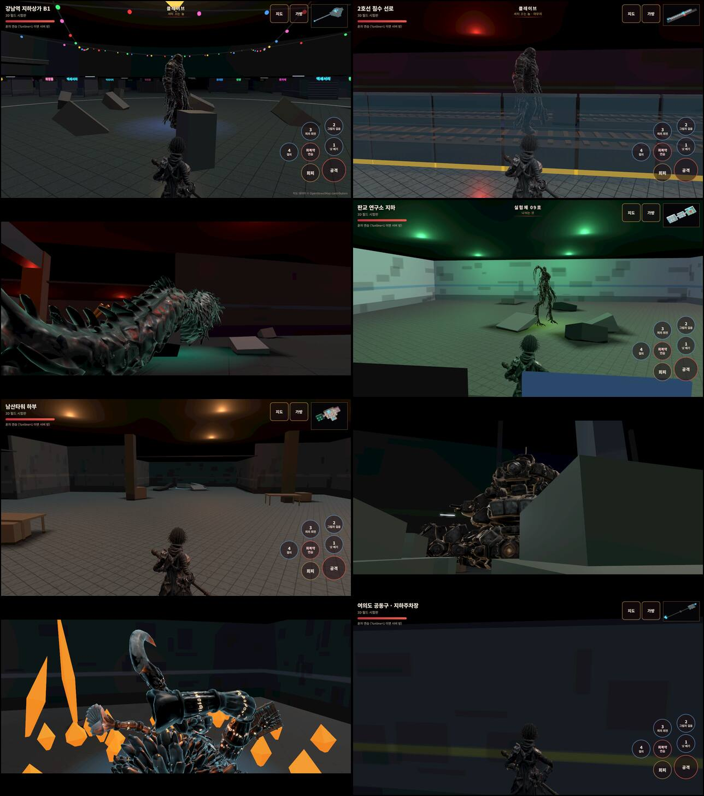
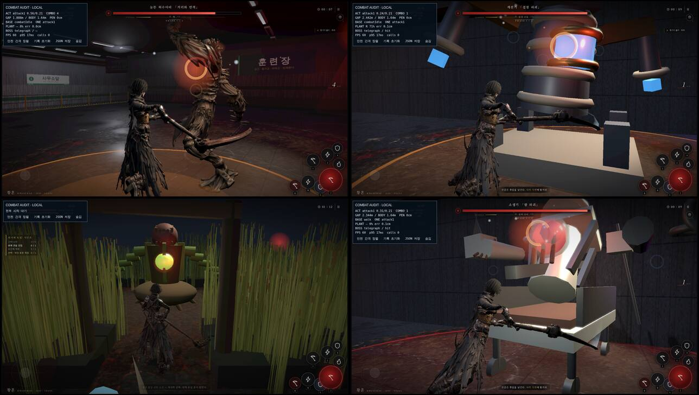
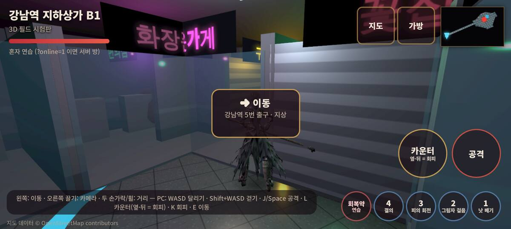
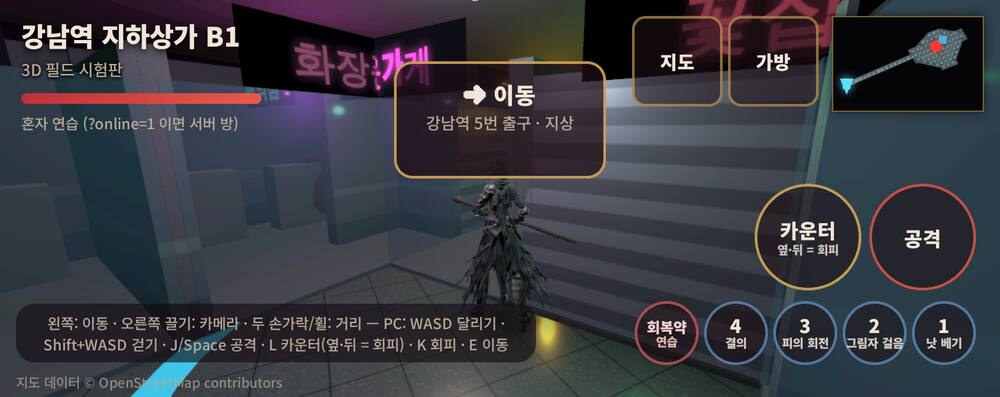
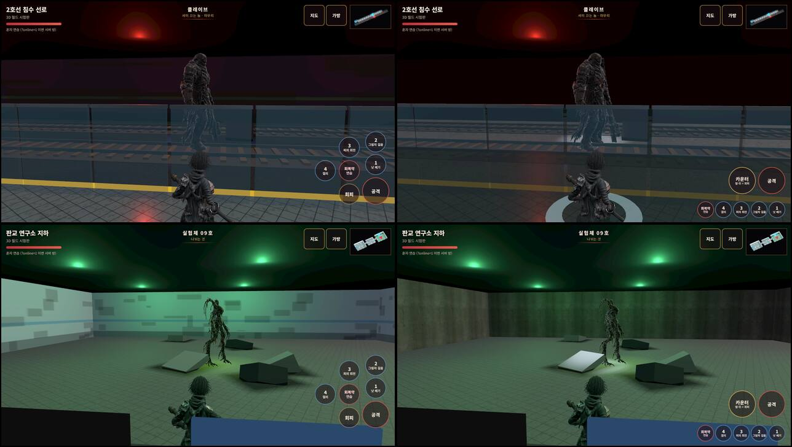
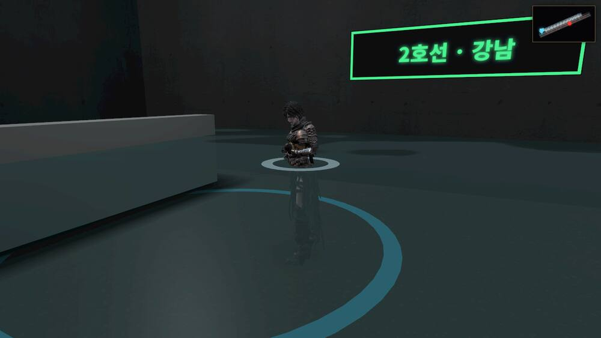

# 231 · 보스 던전 — 지금 어디까지 있나 · 조작 손그림

디렉터 2026-10-13: «이쯤되면 보스들 던전을 진행해야될거 같은데» + 손그림(이동키 · 카운터 · 공격 · 스킬 ○○○).

## 1. 현황 — 두 벌의 «보스 던전»

| | 어디 | 보스 몸 | 싸움 | 배경 |
|---|---|---|---|---|
| **3D 필드 던전 지역** 8곳 (`world3d.html?zone=…`) | 강남 지하상가 B1 · 2호선 침수 선로 · 한강 침수 터널 · 판교 연구소 지하 · 남산타워 하부 · 계룡 격납고 · 고흥 발사대 갱도 · 여의도 공동구 | Hi3D 몸 (`art/3d/part1/*.glb`) — 클레이브·레비아탄·실험체 09호·아스널·나노-노바. **드로퍼·박 준장은 몸이 없다** (`model: null`) | 클레이브만 진짜 AI (`server/field-boss-combat.cjs`). 레비아탄·아스널·노바·에이지스·셀레스티얼은 **정지 모델** | `env-indoor.js` 상자 밑그림. **물면이 없다** (map.json `water.y` 는 2D 만 그렸다 — 침수 선로 1.15 m · 한강 터널 1.2 m · 지하상가 0.9 m) · **형광등 깜빡임 없음** · 사진 재질 없음 · 안개 없음 |
| **스토리 던전** d01~d07 (`game3d.html?d=dNN`) | 훈련장 · 갈대습지 · 정화장 · 변전소 · 식물원 · 수송로 · 폐병원 | d01·d02 만 GLB. **d03~d07 은 절차적 상자·원통 리그** (`js/relay-boss.js` 등 — 파란 정육면체가 접점) | 전부 진짜 (연계·지연타·부위 파괴·반격창, 문서 18) | 벙커·늪 밑그림 |

찍은 법: `/tmp/claude-0/dg/zoneshot.mjs` (map.json 보스 자리로 순간이동 → `__W3D.view`) · `dgshot.mjs` (fight-overlap 의 가상 시계 + 렌더는 마지막 프레임만 — 매 프레임 렌더하면 d01 한 장에 10분이 넘었다).
d05·d06 은 탐사 필수 지점이 열리지 않아 전투에 못 들어갔다(스크립트 쪽 문제, 던전은 멀쩡).

## 2. 무엇이 «연출»이고 무엇이 «노는 방식»인가

CLAUDE.md §1.6 — 배경은 묻지 않고, 노는 방식은 먼저 묻는다.

- **바로 한다 (배경)**: 던전 물면(3D) · 형광등 깜빡임(3D) · 사진 재질 벽·바닥 · 비상등 · 먼지 · 안개 · 보스 방 조명 · 소품.
- **먼저 묻는다 (노는 방식)**: 정지 보스 다섯의 AI (기술표형 `field-boss-kit` 로 — 서버 변경 = GPT 재배포) · d03~d07 상자 보스의 진짜 몸 (Hi3D 크레딧) · 드로퍼·박 준장 몸 · 던전 입장 흐름.

## 3. 조작 손그림 → `world3d.html`

손그림: 왼쪽 «이동키» 원 · 오른쪽 «카운터» «공격» 큰 원 둘 · 그 아래 «스킬» 작은 원 셋.

| 그림 | 구현 |
|---|---|
| 이동키 | 그대로 (왼쪽 45% 어디나 누르면 스틱) |
| 카운터 | 회피 단추 자리에 84 px «카운터 · 옆·뒤 = 회피». 던전 L 단추와 같은 뜻 — 이동키를 옆·뒤로 밀고 있으면 회피, 아니면 **맞대기**(`counter` 클립 한 타 → `strike`). 반격 창 안에 닿으면 반격 ×1.65 + 보스 경직, 밖이면 보통 한 타. 서버는 손대지 않았다(온라인도 같은 `fieldHit`). PC 는 L |
| 공격 | 84 px, 같은 줄 오른쪽 |
| 스킬 ○○○ | 1~4 + 회복약을 **50 px 한 줄** 로 맨 아래 (오른쪽부터 1 2 3 4 약). 그림은 셋인데 우리 표는 넷 + 약 — 줄일지 디렉터에게 물었다 |

낮은 가로(750×298)는 큰 둘 76 px · 작은 줄 44 px (위 끝 162 px — 미니맵과 안 겹침, `tests/world3d-bench.test.mjs`). 세로는 회복약을 공격 위로 (스킬 줄이 이동 자리까지 안 닿게) · 안내 띠를 단추 위로.

스토리 던전(`game3d.html`)의 조작은 아직 옛 배치(스킬 4 · 회피 · 점프 · 카운터 · 공격 · 궁극기)다 — 같은 그림으로 바꿀지 물었다.

## 4. 던전 배경 (§2 «바로 한다» 쪽) — 첫 묶음

| 무엇 | 어떻게 | 확인 |
|---|---|---|
| 물면 | `world3d.html DWATER` — map.json `water.y` 에 900 m 반투명 잔물결 판(`waterMat calm`, 불투명 0.84, 탁한 녹회색). 하늘 돔이 없으니 `WATER.uTop/uHor` 를 어두운 천장색으로, 해는 끈다(`uSun.y = −1`). 발 둘레 물결 고리 | 첫 판(0x06080a · 0.74)은 유리판처럼 안 읽혔다 → 천장색 0x161c20/0x3a4a50 · 0.84 로. 옆에서 낮게 찍으면 허리까지 잠긴 영웅이 보인다 |
| 형광등 깜빡임 | `FLICK` — 원작 «3초 켜짐 1초 꺼짐». 꺼지면 반구광 ×0.35 · 점광 풀 ×0.12(`flickK`) · 형광등 막대 색 0x161a1e · 켜질 때 0.08~0.18 초 더듬음. 상태가 바뀔 때만 손댄다 | 100 프레임 밀어 재니 상태 1→0→2, 반구광 1.8→0.63→1.26, 막대 eaf8ff→161a1e→7a8a90 |
| 사진 재질 | `env-indoor` · `env-dungeon`: 벽 = `concrete_wall_006` × 테마색 2.1배, 벽 조각마다 UV 를 미터로(`ph-tex boxWorldUv` — 조각이 1~60 m 라 재질 repeat 로는 늘어난다). 바닥은 콘크리트(`concrete_layers`)·아스팔트·자갈(`concrete_debris`)만 | 판교 연구소 벽에 콘크리트 결이 선다 (아래 시트 오른쪽) |
| 보스 방 빛 | 보스 자리 위 천장 `SpotLight(0xcfe0ff, 90)` — 점광은 가까운 8개만 켜지지만 스포트는 남는다 | 지하상가 클레이브 발밑이 밝다 |
| 안개 | `theme.fogDist` → `env.fogDist` → world3d 실내 안개. 침수 선로 [9,46] · 한강 터널 [8,42] · 지하상가 [12,56] | |

남은 것(배경): 천장에서 떨어지는 물방울·먼지 · 벽 얼룩·긁힘 사진 · 남산타워·여의도·격납고 방별 정체성 · 휴대폰 무게 재기.
