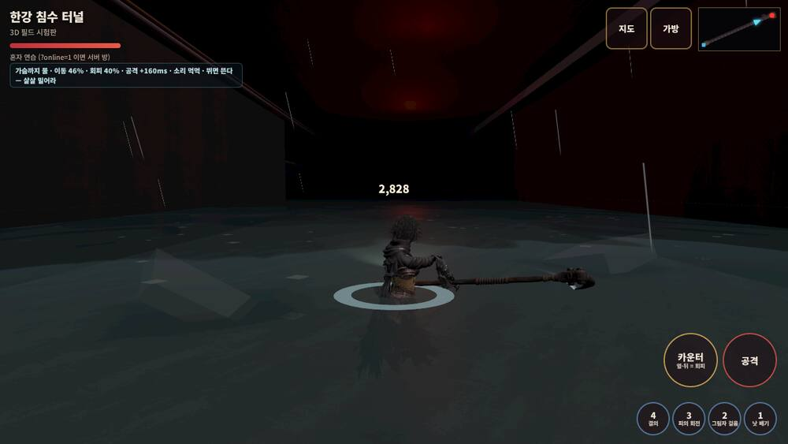

# 232 · 전투 환경 변수 — 소설대로 (물의 저항 · 움직임 · 소리 · 시야)

디렉터 2026-10-13: «전투환경을 최대한 리얼하게 소설에 맞춰서 구현하자. 물의 저항. 움직임등 많은 변수를 기록해서 구현하자».

숫자는 **`js/mmo/env-rules.js` 한 장**에 다 있다. 원문 줄 번호는 `docs/story/source/제1부_통합본_EP01-28.md`.
3D 필드(`world3d.html`)가 매 프레임 내 자리의 수면 높이로 «띠» 를 정하고, 띠가 이동·회피·공격·소리·시야를 정한다. 서버는 손대지 않았다 — 느려지는 쪽이라 `MAX_SPEED` 검사 안이고, 회피 무적 시간은 서버 그대로(뒷걸음 거리만 줄인다).

## 1. 물 깊이 띠 (`WATER_BANDS`)

| 띠 | 깊이(m) | 이동 | 회피 뒷걸음 | 공격 지연 | 소리 먹먹 | 안개 앞 | 뜸 | 밀려나면 반 바퀴 | 원문 |
|---|---|---|---|---|---|---|---|---|---|
| 발목 | 0.12~ | 94 % | 95 % | 0 | 0 | 1.0 | 0 | — | 여의도 공동구 «물이 발목까지» L5978 |
| 무릎 | 0.4~ | 80 % | 80 % | +40 ms | 0.1 | 1.0 | 0 | — | |
| 허리 | 0.75~ | 62 % | 60 % | +90 ms | 0.35 | 0.9 | 0.2 | ○ | 지하상가 «허리까지 잠겨» L1359 · 한강 «허리» L7430 |
| 가슴 | 1.05~ | 46 % | 40 % | +160 ms | 0.6 | 0.75 | 0.55 | ○ | 2호선 선로 «가슴까지» L1540·L3348·L3988 |
| 어깨 | 1.3~ | 34 % | 25 % | +220 ms | 0.8 | 0.6 | 0.9 | ○ | 한강 «허리, 가슴, 그리고 어깨» L7430 |

- **공격 지연** — «낫이 오른쪽으로 돌았다. 물의 저항 때문에 반 박자 느렸지만 각도는 정확했다» (L7454). 공격·맞대기를 누르면 그 ms 뒤에 **통째로** 나간다(접점 시각은 동작 안에서 그대로 — 애니 속도를 늦추면 판정과 어긋난다).
- **뜸** — «발 들면 몸이 뜹니다. 뜨면 방향을 잃어요» (L7432). 스틱을 0.55 넘게 밀면(달리기) 속도가 `1 − 0.3 × 뜸` 으로 더 줄고 방향이 `1.1 × 뜸` rad/s 진폭으로 흔들린다. 살살 밀면(걷기·Shift) 바닥을 쓸듯 민다 — 그게 더 빠르다. 환경 띠가 «뛰면 뜬다 — 살살 밀어라» 라고 알려 준다.
- **반 바퀴** — «아인의 몸이 물속에서 반 바퀴 돌았다» (L7458). 허리 위 물에서 보스에게 밀려나면 0.45 초에 180° 돈다 (검수: 180°).
- **소리** — «아인은 소리를 듣지 않았다. 대신 부유물이 밀리는 방향을 봤다» (L7651). `sfx.muffle(k)`: 마스터에 저역 통과 — 0 이면 그대로, 1 이면 700 Hz 아래만.
- **시야** — «물속에서 눈은 느리고 좁았지만» (L7647). 안개 앞 거리 × vis, 어깨 깊이에선 헤드램프 9 → 6 m («빛이 닿는 거리»).

## 2. 깊이 경사 (`theme.waterGrade`)

«삼백 미터 지점부터 물이었다. 허리, 가슴, 그리고 어깨» (L7428~). 한강 터널은 `[[24, 0.15], [120, 0.5], [200, 0.9], [260, 1.15], [330, 1.45]]` — 입구 발목에서 차수문 앞 어깨까지. 수면은 길 좌표 s 를 따라 꺾인 판 한 장, 깊이는 `yAt(x, z)`. 벽 물때 띠도 그 자리 높이. 2D·서버의 `water.y` 는 1.2 한 높이 그대로.

검수(`/tmp/claude-0/dg/envprobe.mjs`): s 30 → 발목 0.17 · 100 → 무릎 0.43 · 220 → 허리 0.98 · 270 → 가슴 1.19 · 340 → 어깨 1.45, 안개 앞 9 → 5.4 m.

## 3. 부유물 (`water-fx.js floaters`)

수면의 티끌 160 개(휴대폰 90)가 카메라 앞 18 m 상자에서 느리게 떠돈다. **보스가 예고 중이면 보스에서 멀어지는 쪽으로 1.6 m/s 밀린다** — «밀린다는 것은 그쪽에서 뭔가가 왔다는 뜻» (L7651). 깊을수록 소리가 안 들리니 이게 읽을 거리다. `?floaters=0`.

## 4. 어둠 · 깜빡임 (문서 231 에서 넘어온 것, 숫자만 여기로)

- 헤드램프 9 m (`LAMP.reach`), 어깨 깊이 6 m. 머리 앞 0.55 m 에서 쏜다 — 머리 자리에 두면 내 얼굴이 원뿔 안에 들어가 하얗게 탔다.
- 형광등 «3초 켜짐. 1초 꺼짐» (L1361): 꺼진 박자 반구광 0.35 · 점광 0.12.
- 유도등 «절반쯤 살아서 초록의 점선» (L12516) · 소독약 복도 «비상등이 살아 있었고» (L13229) — 방 테마.

## 4.5 둘째 묶음

| 무엇 | 규칙 | 원문 |
|---|---|---|
| 젖은 옷 | 허리 위 물에서 나오면 10 초: 처음 5 초 이동 92 %·회피 95 %, 뒤 5 초 서서히 마른다. 환경 띠 «젖은 옷 — 이동 92% (n초)» | «젖은 테크웨어의 무게도 덜 느껴졌다» L4110 |
| 물보라 | 허리 위 물에서 밀려나면 발 둘레 고리가 3.2 배로 터지며 0.45 초에 사라진다 | «되돌아온 반동에 아인이 물속으로 나가떨어졌다» L1896 · L2856 |
| 유도등 | 계룡 경사로 벽 무릎 높이 초록 점선 2.2 m 간격, 절반만 살아서 빛 (`env-indoor guides`) | «유도등은 절반쯤 살아서 초록의 점선» L12516 |

## 5. 아직 안 한 것 (디렉터 결정)

- 보스도 물에서 느려지나? 클레이브(3.2 m)는 가슴 깊이 선로에서 허리. 레비아탄은 물의 것이라 오히려 빠르다. 서버 AI 라 GPT 몫 (`docs/gpt/2026-10-13-bosses-all.md` 에 적었다).
- 추위 · 미끄러운 바닥(«길이 미끄러워서» L13882 — 류의 산책길이라 던전 근거는 아니다) · 잔해 걸림 — 숫자만 더하면 된다.
